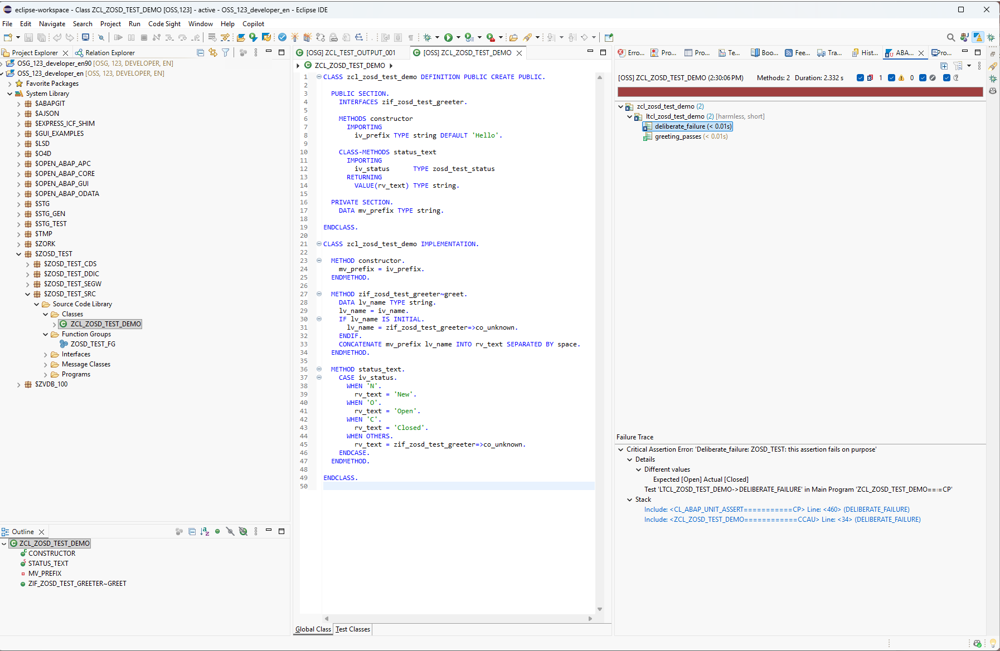
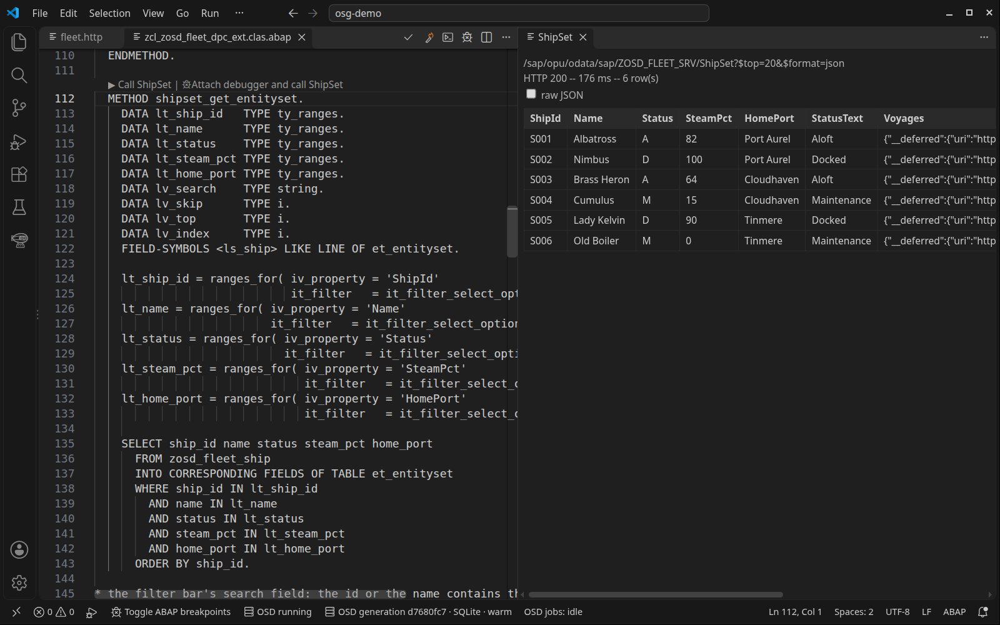
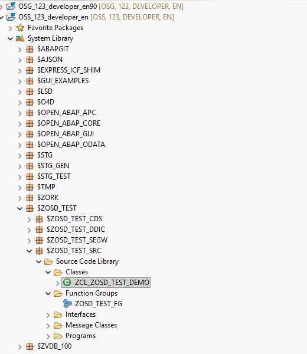
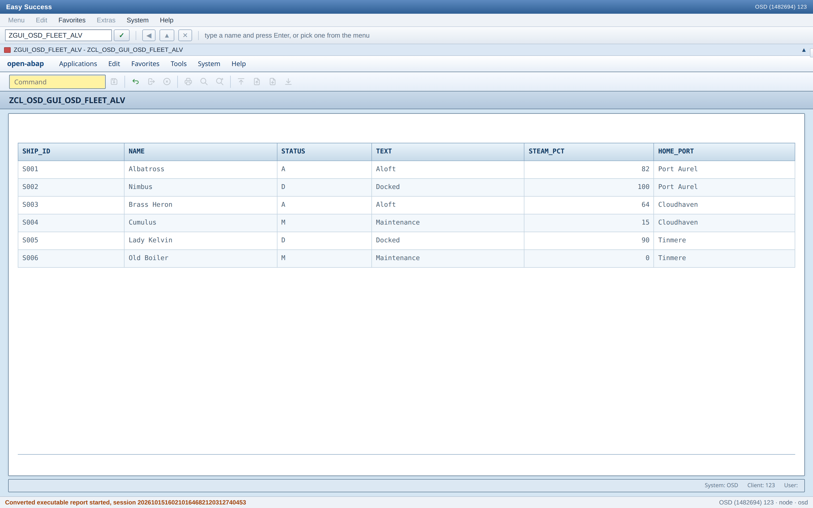
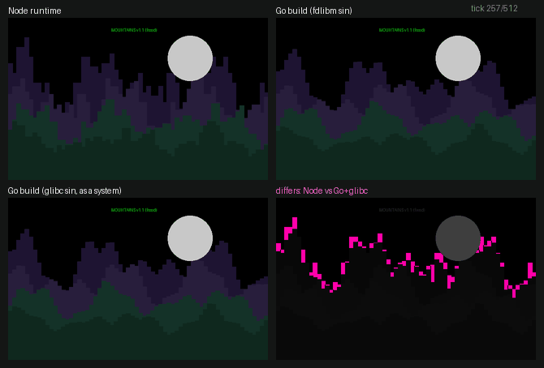
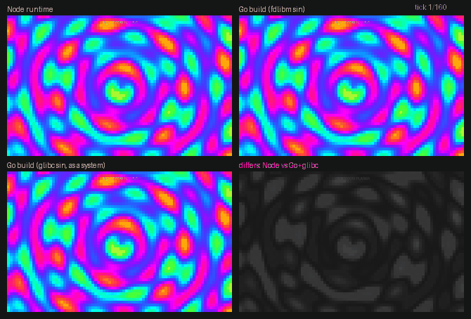
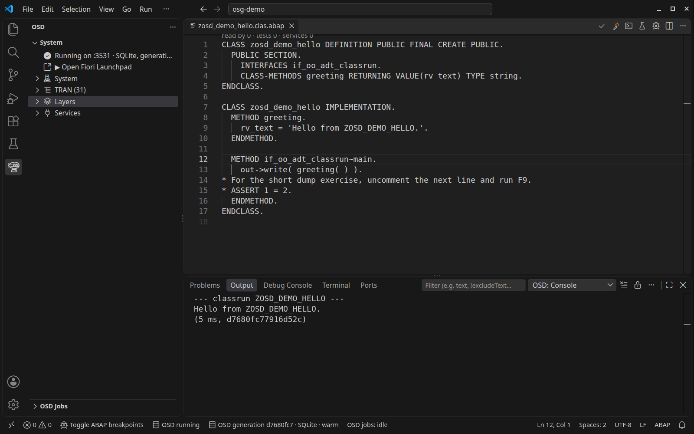

# I only wanted to run a little ABAP

*…and now there is a pocket ABAP runtime inside a VS Code extension. =)*

TL;DR: start here: [launchpad/Sysinfo](https://oisee.github.io/open-steamgate/main/app/flp.html#Shell-home) · github: [open-steamgate](https://github.com/oisee/open-steamgate/tree/vscode-stable-v0.7.1696) | [osg-demo](https://github.com/oisee/osg-demo)

Ask an ABAP developer what they need to start developing in ABAP, and you'll get a small history of our tools. Somebody will say SE38, somebody will remember practically living in SE80, then we get to Eclipse and ADT, VS Code and abap-fs, and eventually somebody mentions MCP and vibing-steampunk.

And of course we need an agent now. Claude, Codex, Pi, GitHub Copilot… perhaps several of them, although I would quite like them to have separate copies of whatever they are about to enthusiastically improve.

All of these give us different ways to work, but somewhere underneath them — underneath the editor, underneath the agent, underneath the whole modern conversation about how modern everything has become — we arrive at the same requirement: you need a system.

And I do like having a system. I'm grateful to SAP for the Developer Trials; a real system to validate against before anything goes further is invaluable.

But sometimes I want to try something much smaller. Or much faster. Change a method, see what comes back from an OData service, adjust a CDS view and check what the Fiori application makes of it — preferably while I still remember what I was trying to find out, rather than after I've wandered off during the build. Or try two implementations at once. Or let a second agent work on the same problem, before the first one develops opinions about shared state.

A modest wish. All my expensive side quests begin with a modest wish.

So I started wondering how much of that loop we could have locally: ABAP source, a database, some services, the tools we already know — enough to develop and run an application without attaching a SAP application server. Over the past couple of months that question turned into Open SteamGate, and before I get distracted explaining how, here is where it ended up: stock Eclipse ADT, connected to a local OSG instance, opening classes and running ABAP Unit. The system behind that connection is a folder of files and a local process.

*Eclipse: the local system, an open class, and the test results.*

Yes, the red test is intentional. The system should be able to disagree with us as well.

## First, we need to talk about Lars

"But Alice," you may reasonably interrupt, "haven't you already been doing unreasonable things with ABAP and a Z80?"

Yes. But before we get carried away by the small antique processor: none of this would have got anywhere without Lars Hvam Petersen — [abaplint](https://github.com/abaplint/abaplint), its [ABAP-to-JavaScript transpiler](https://github.com/abaplint/transpiler) and the [open-abap](https://github.com/open-abap) libraries.

abaplint has been around for about a decade, and the transpiler has been running ABAP outside SAP for years too — abapGit's own ABAP Unit tests run on it in CI. There is an enormous amount of engineering in being able to parse ABAP, understand its structure, translate it, and then provide the runtime behaviour the translated program expects.

But it's quite easy to miss how much is there, especially if continuous integration hasn't yet become part of your everyday ABAP life. You hear "abaplint" and think: a linter. You see a green check on a pull request and think: good, the checks are happy. Meanwhile somebody's ABAP has actually compiled and run outside a SAP system, which is a much bigger thing than the little green icon has room to explain.

For those of us who met that ecosystem through lint checks and pipelines, there was a rather large door hiding behind the green tick. I eventually went through it.

Naturally, I took a screwdriver.

## What if we put a Gateway in front of it?

My original interest was the OData loop, so this seemed like the reasonable place to start — and it was the first of a series of reasonable places, each of which, it turned out, had brought a friend.

Take the familiar MPC and DPC classes from a classic SEGW service and give them an independent implementation of the framework they expect. The MPC describes the model, the DPC handles the request, Open SQL talks to a local database, and an OData v2 endpoint makes the whole thing callable. Then a Fiori application asks for data and gets an answer produced by the ABAP service implementation, and you can change that implementation and see the effect in the application. That was the loop I was after.

*The service method in VS Code and its OData response: HTTP 200, six airships.*

Once that worked, CDS was fairly irresistible: another way to describe and expose the data, and naturally I wanted that too. And yes, AMDP as well — with HANA Express connected, the SQLScript body of an ABAP-managed database procedure runs on HANA itself, and there is a portable AMDP subset that runs on DuckDB without HANA (from a source checkout; the SQLite inside the VS Code extension is not a target for it yet). So the local experiment can include database-side logic rather than stopping at the boundary of the method.

At this point a sensible person writes a README and goes for a walk. I had the tea.

## ADT said it would only take a moment

We had enough working pieces that editing source in a folder and invoking everything separately started to feel unnecessarily awkward. We already have ABAP development tools. Couldn't they just connect to this thing?

Well… that meant ADT, and ADT is a particularly convincing guest. First it asks the system who it is. Then what it can do. Then where the packages are. Then whether it may open a class. By the time you have answered politely, it has brought an editor and would like to save something — and none of those requests is surprising on its own, it's just that together they start to resemble a development system.

ADT asked who the system was. The system was a folder. ADT accepted this.

So OSG grew an ADT façade over the local source tree: repository browsing, source editing, checks, activation, unit tests, data preview. Supported operations work against the local runtime, and changes land in files you can see in Git. VSP uses parts of that interface, and there is a conformance harness running the ADT client that ships with abap-fs against it, which is how I know, in writing, where the edges are.

A thank you here to Marcello Urbani for abap-fs and abap-adt-api, and to Aravindh Ganapathi for his contributions to abap-fs. Being able to work with the tools people already use is what makes this interesting to me, rather than having yet another isolated runtime with its own special way of doing everything.

Implementing the server side of ADT turned out to be the easier half of the conversation, and the reason is the open client side. Between abap-fs and VSP, practically the whole surface was already known: every request they make, every header they expect, every shape they are prepared to parse. The job was to trace around the outline of the client and draw in the missing piece of the puzzle — the piece the client had always been talking to, and which had simply never been open before.

I wrote that piece in JavaScript first, because that is where the runtime lives. Then I rewrote it in ABAP, and there were reasons. If we can transpile ABAP to JavaScript — and, as it turns out, to a Z80 — then we can transpile it to other backends too, and a façade written once in the lingua franca can follow the runtime wherever it goes next. So the ADT server is ABAP now: ABAP serving ADT so that ABAP tools can edit ABAP, which is either very elegant or slightly recursive, and I have decided it is elegant.

And then Eclipse arrived. Yep, Eclipse. Stock ADT, with the local system registered in Eclipse as a Custom Application Server: open the package tree, edit a class, run the tests against the local filesystem.

*Eclipse Project Explorer: $O4D, $LSD, $ZORK, $OPEN_ABAP_APC, $ZOSD_TEST.*

![ABAP Unit in Eclipse: greeting_passes green, deliberate_failure red with "Expected [Open] Actual [Closed]" and its stack](img/04-eclipse-abap-unit.png)

*ABAP Unit in Eclipse: greeting_passes green, deliberate_failure red.*

This is the bit I keep wanting to show people. There is something quietly wonderful about an IDE opening a repository tree while the "system" at the other end is a collection of files and a local process you can go and look at. The furniture is familiar. The building has become portable.

There is a local WebGUI-style interface too, with converted classic reports. I'm going to resist turning this paragraph into another article, but yes, "could we also give it a GUI?" did come up, and the answer was partly yes. (via [open-abap-gui](https://github.com/open-abap/open-abap-gui)).

*A classic ALV report in the local WebGUI.*

A blue screen is a strong substance; it makes a person assume an entire transaction catalogue behind it. We haven't put an ERP behind the curtain. We've built parts of an application-server runtime with a bounded, growing set of behaviours. The curtain is in Git. You can inspect it.

## Okay, but what would you actually use it for?

For me the interesting part is what happens when the environment becomes something you can copy and keep alongside an experiment.

Suppose you're refactoring a service. Run the original implementation in one instance and the changed version in another, each with its own database and the same starting data, and compare the OData responses, the SQL, the place where they diverge. That's what I mean by branching the system: the experiment includes the runtime, the object definitions and the data, not just a branch of source code that still depends on whatever is installed in a shared development system.

Or give an agent a room of its own, where it can edit, activate, run tests and find out what it broke while your copy carries on working — off-stack, on a local runtime that is not a SAP system and doesn't talk to one. Several agents may still disagree, but no longer inside the same system. When the work is ready it travels the last mile the way any developer's code does: through abapGit, reviewed, with a person at the keyboard.

And because the runtime is ours, it can be as talkative as we like. A real application server tells you what it is prepared to tell you: a log here, a trace there, a dump if you're lucky. This one can write down everything — every dialog step, every statement, every commit, every message on every channel — the trace of the whole universe, if you want it. Take a snapshot of the system before a request and another after it, and you have a time machine: rewind, replay, step through the same request against the same data until you find the exact place where it went wrong. Root-cause analysis from snapshots rather than from SM21 and a hunch. Nobody has to reproduce the bug on Monday morning; the bug is in the folder.

Then there is the fact that both ends of the loop are JavaScript. The transpiled ABAP, the OData runtime, the database — and the Fiori application in front of them. There is no reason for the "server" to be a separate process at all, so there is a version where it isn't: the whole thing, backend and frontend, lives inside a browser tab in a Service Worker. An ABAP server you can open from a link. Hand somebody a URL and they have a system, with your service and your data in it, and nothing to install. I find this quietly absurd, and I mean that as a compliment. Behold!

And of course, once you have a push channel and a runtime you can see into, somebody is going to write a demo. =) So there is a chapter where the fleet is left to rest and the push channel draws mountains and a rotating tesseract, one frame per APC message. That started as showing off and turned into an instrument. The demos run on more than one build of the runtime — Node, and two Go builds — and a plotted landscape is a very honest test: where the arithmetic differs, the picture differs, and you can see it without a diff tool. The Node runtime drew the mountains with gently rounded ridges because, deep in the generated code, `abs( … )` had been declared as an integer. The Go builds drew them sharp. The sine functions disagreed too [Node vs glibc]; the two Go builds between themselves didn't disagree at all. A frame-by-frame comparison of two GIFs found compiler and runtime differences that no unit test had thought to look for. Any demoscener could have told me this; I just had to rediscover it in ABAP.

There are limits, of course, and I'll say them once. OSG is an independent implementation of a subset of ABAP application-server behaviour, not a replacement for SAP and not a complete implementation of its stack. The supported workflows and the compatibility gaps are documented, including the harness scenario that currently fails, and code intended for a real SAP system still needs validating on that system. The point is to do more of the developing and experimenting locally, with a deliberate step back to SAP when the application is ready.

I've been calling it OSG — Open SteamGate, although you'll also find OSD — Off-Stack Doppelgänger in the code and the interface. I liked both names and didn't quite manage to choose, which is why you're reading about OSG and will shortly be pressing a button called "Start OSD". =)

## And then we put it inside VS Code

Because after building all of this, asking people to assemble the environment before trying it felt like rather a lot of homework.

The extension carries a system seed, its dependencies and a prebuilt generation. When you start it, it prepares a writable local copy and brings the system up — so it gives you a local ABAP environment of your own, not just another way to connect to a remote one. Which means there is now an ABAP runtime inside your VS Code extension, and the extension starts it for you.

Install the [stable VSIX](https://github.com/oisee/open-steamgate/releases/tag/vscode-stable-v0.7.1696) with **Extensions: Install from VSIX…**. For a standalone instance there is a [Docker Compose setup](https://github.com/oisee/open-steamgate/blob/vscode-stable-v0.7.1696/docker/compose.sqlite.yml), and the [connection guide](https://github.com/oisee/open-steamgate/blob/vscode-stable-v0.7.1696/docs/adt-over-rfc.md) describes how to point Eclipse at it. There is also a browser-only version — transpiled ABAP, the OData runtime and a local database inside a Service Worker — for the days when even an extension is too much.

But I'd start with the extension and osg-demo, because then you have something to explore immediately.

## And… there is a book. Of course there is a book.

Do you like longreads? =) I love books!

Yeah, I know. We were talking about running a little ABAP and now I'm asking you to consider a book about an airship fleet. The connection is that the fleet is the example application: six airships and twenty voyages, with classes, tests, debugging, services, a Fiori application, CDS, AMDP, logs and background jobs. The illustrated chapters follow the application as it grows and say what to try, what to expect, and where the local behaviour differs from SAP; English and Russian ([latest release](https://github.com/oisee/osg-demo/releases/latest)). One of the airships is called Old Boiler. I felt that an application server escaping its usual surroundings should have suitable transport.

You don't need to read it before doing anything, though. Clone the [demo](https://github.com/oisee/osg-demo), open its folder in VS Code, start OSD, open `ZOSD_DEMO_HELLO` and press **F9**. You should get "Hello from ZOSD_DEMO_HELLO." in the console.

*ZOSD_DEMO_HELLO, the running system and its greeting in the console.*

And there we are: a little ABAP, running.

There was one thing I did not expect from all this. Rebuilding the environment I needed taught me a great deal about how SAP's own application server is put together — mostly by sending me back to the documentation. Again and again the conversation went the same way. How do I make this work? Well, like this, probably. Ooh. And how does a real ABAP application server do it? We would go and read — the ABAP Keyword Documentation, the Basis administration book by Föse, Hagemann and Will, *SAP Gateway and OData* for the Gateway side, *Core Data Services for ABAP* for CDS and AMDP — and: oh. Almost exactly the same. *That's* why. =)

Why does every message on a push channel run as a dialog step of its own, with its own commit? Why does a restarted daemon come back with nothing in its attributes? It's all in the keyword documentation, under database LUW and the ABAP Daemon Framework. You just don't go looking until you need the answer yourself — and then discover that somebody at SAP needed it, too, a long time ago.

If you want to see where that left us, the [architecture](https://github.com/oisee/open-steamgate/tree/vscode-stable-v0.7.1696#architecture) is one picture in the README: a pool of work processes behind a proxy, ICF and APC in front of the Gateway, a seam to the database. The names will look familiar. That was not entirely the plan.

It took rather more than a little ABAP to get here, but you get to start with the button. I have more to tell you about where the next question led — it led, unexpectedly, to compiling the tools themselves — but first I wanted to finally show you this one.

Meet Open SteamGate — an off-stack ABAP system, a VS Code extension, a Docker container(s), a friendly bay for your agents.

[open-steamgate](https://github.com/oisee/open-steamgate/tree/vscode-stable-v0.7.1696) · [osg-demo](https://github.com/oisee/osg-demo)
