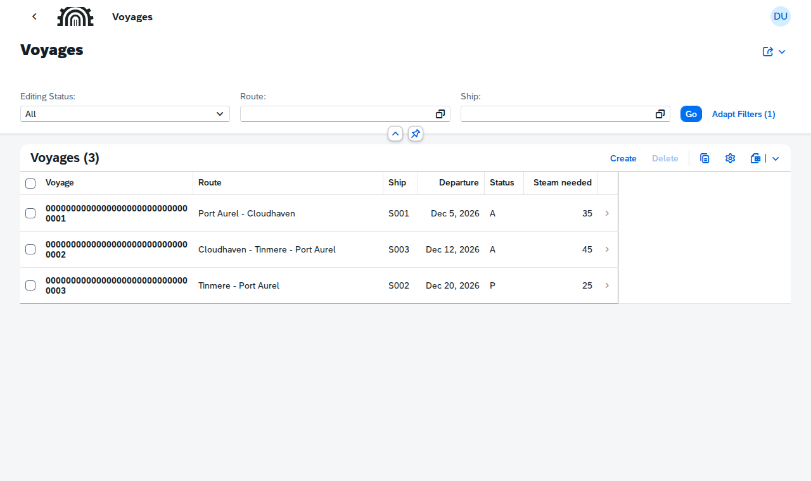
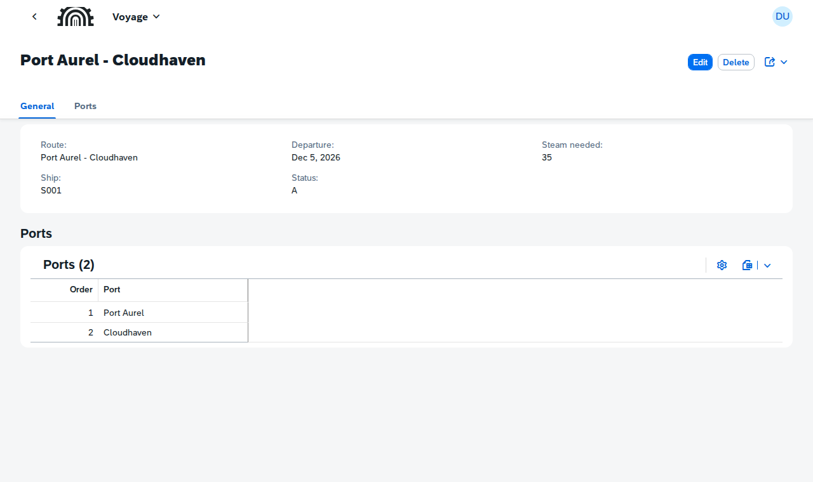
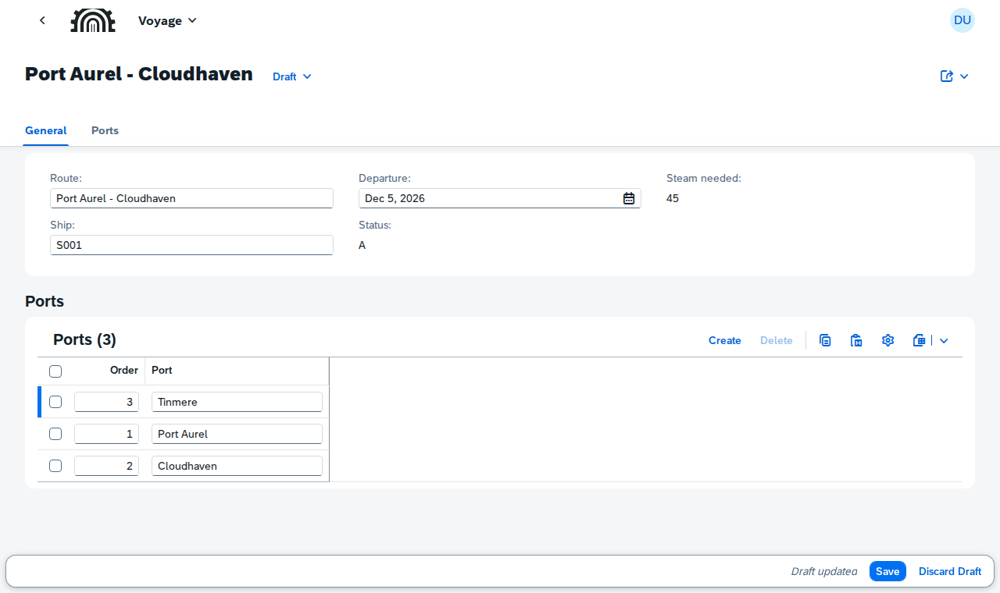

# 21. Voyages as a business object: RAP

Chapters 3 to 5 built the fleet's service the classic way. A YAML file
described the OData model, a hand-written `DPC_EXT` filled what the model could
not, and CDS views added a cube. ABAP's newer model, the ABAP RESTful
Application Programming Model (RAP), describes a *business object* once.
CDS views give its shape. A behavior definition says what may happen to it.
A behavior pool, ordinary ABAP, holds the rules. The framework does the rest:
the transactional buffer, drafts, locks, ETags, and the OData V4 service a
Fiori Elements app talks to.

open-steamgate runs managed RAP. It reads the behavior definition, generates
the types the statements need, keeps the instances in a buffer until the
save sequence writes them, and serves a service definition over OData V2
and V4 ([docs/rap-runtime.md](https://github.com/oisee/open-steamgate/blob/vscode-stable-v0.7.3140/docs/rap-runtime.md)).
EML, the statements `MODIFY ENTITIES`, `READ ENTITIES`, `COMMIT ENTITIES`
and `ROLLBACK ENTITIES`, is lowered by the transpiler onto that runtime
([docs/rap-eml.md](https://github.com/oisee/open-steamgate/blob/vscode-stable-v0.7.3140/docs/rap-eml.md)).

This chapter gives the fleet a RAP object of its own: **voyages**, each
with the ports it calls at. Its sources are in [src/rap/](../src/rap/);
`test/rap.mjs` checks everything below (appendix A).

## Plan a voyage

The system runs as in chapter 1. The URLs assume port 8099.

1. Open the launchpad and the **Voyages** tile. Expected: a list report
   with three voyages: S001 *Port Aurel - Cloudhaven*, status `A`, steam
   needed 35; S003 *Cloudhaven - Tinmere - Port Aurel*, `A`, 45; S002
   *Tinmere - Port Aurel*, `P`, 25. The first column is the voyage's key, a
   UUID; the status shows its code.

   

2. Open the S001 voyage. Expected: its object page, with **General**
   (route, ship, departure, status, steam needed) and **Ports**: Port Aurel
   and Cloudhaven. A voyage needs 15 units of steam to raise the ship and
   10 more for every port it calls at, so two ports make 35.

   

3. Press **Edit**. In **Ports** press **Create**, replace the order `0` with `3`,
   type port `Tinmere`, and leave the field. Expected: **Draft** beside the title,
   the new row on top of the table, and steam needed 45. Nothing is saved
   yet: you are editing a *draft*, a copy of the voyage that lives beside
   the active one until you save or discard it. Press **Discard Draft** and
   confirm: the voyage is as it was, with two ports and 35.

   

4. Back in the list, press **Create**. Expected: a page *New: Voyage*,
   already with status `P` and steam needed 15. Enter a route and ship
   `S005`, add one port as in step 3, then press **Create** in the footer
   (a new object has no Save). Expected: *Object created*, status `P`
   (planned), steam needed 25.
5. Plan one for a ship the fleet does not have: **Create**, route
   `Nowhere`, ship `S999`, and **Create** in the footer. Expected: an error
   dialog with `Ship S999 is not in the fleet` (twice: once for Prepare,
   once for Activate). Close it and press **Discard Draft**: the list has
   no new voyage. Until you discard, the list shows the refused voyage as a
   draft row.
6. Approve S002's planned voyage. The app has no button for it; the
   service has the action:

   ```
   B=http://localhost:8099/sap/opu/odata4/sap/ZUI_OSD_FLEET_VOY
   T=$(curl -s -c jar -D - -o /dev/null -H "x-csrf-token: fetch" "$B/" | grep -i '^x-csrf-token' | tr -d '\r' | cut -d' ' -f2)
   curl -s -b jar -X POST -H "x-csrf-token: $T" -H "Content-Type: application/json" -H "If-Match: *" -d '{}' \
     "$B/Voyage(voyage_uuid='00000000000000000000000000000003',IsActiveEntity=true)/ZUI_OSD_FLEET_VOY.Approve"
   ```

   Expected: the voyage comes back as JSON with `"status":"A"`. Reload the
   list: S002's voyage is approved.
7. The service's model: `$B/$metadata`. Expected: `VoyageType` and
   `StopType`, each keyed by its UUID and `IsActiveEntity`; the bound
   actions `Edit`, `Activate`, `Prepare`, `Resume`, `Approve` and
   `Cancel`; and `Common.DraftRoot` on the `Voyage` set. There is no
   `Discard` action: over OData V4 a draft is discarded with a DELETE.

The data comes from the seed in `data/`, which replaces the rows at every
start, as in chapter 3.

## The object

The shape comes from two CDS view entities. The root, a voyage, owns its
stops through a composition:

<!-- code: src/rap/zi_osd_fleet_voyage.ddls.asddls -->
```
@AccessControl.authorizationCheck: #NOT_REQUIRED
@EndUserText.label: 'Airship fleet: voyages as a RAP business object'
define root view entity ZI_OSD_FLEET_VOYAGE as select from zosd_fleet_voyage
  composition [0..*] of ZI_OSD_FLEET_STOP as _Stops
{
  key voyage_uuid,
      ship_id,
      route,
      dep_date,
      status,
      steam_needed,
      @Semantics.systemDateTime.lastChangedAt: true
      last_changed_at,
      @Semantics.systemDateTime.localInstanceLastChangedAt: true
      local_changed_at,
      _Stops
}
```

The behavior definition holds the whole object in one file. Its voyage
part:

<!-- code: src/rap/zi_osd_fleet_voyage.bdef.asbdef lines 1-36 -->
```
managed implementation in class zbp_osd_fleet_voyage unique;
strict ( 2 );
with draft;

define behavior for ZI_OSD_FLEET_VOYAGE alias Voyage
persistent table zosd_fleet_voyage
draft table zosd_fleet_voyage_d
lock master
total etag last_changed_at
etag master local_changed_at
{
  create;
  update;
  delete;
  field ( numbering : managed, readonly ) voyage_uuid;
  field ( readonly ) status, steam_needed, last_changed_at, local_changed_at;
  field ( mandatory ) route;
  association _Stops { create; with draft; }
  determination SetPlanned on modify { create; }
  determination CalcSteam on modify { create; }
  internal action RecalcSteam;
  validation CheckShip on save { create; field ship_id; }
  action Approve result [1] $self;
  action Cancel result [1] $self;

  draft action Edit;
  draft action Activate optimized;
  draft action Discard;
  draft action Resume;
  draft determine action Prepare
  {
    validation CheckShip;
  }

  mapping for zosd_fleet_voyage corresponding;
}
```

Read it from the top:

- `managed`: the framework writes the tables; the pool only adds rules.
  `with draft` gives every voyage a draft table beside its active one, and
  the draft actions are what the app called in steps 3 to 5: `Edit`,
  `Prepare` and `Activate`, and `Discard`, which reaches the service as a
  DELETE of the draft. `Resume` continues a draft left open earlier.
- `numbering : managed`: the key is a UUID the framework draws.
- `total etag` and `etag master`: optimistic locking, both for the draft
  and for the active voyage.
- `field ( readonly )` on `status` and `steam_needed`: the app cannot set
  them. Only the pool can, through EML in local mode.
- Two determinations, one internal action, one validation and two actions:
  the rules below.

The stop has a shorter definition: it is locked by its voyage
(`lock dependent by _Voyage`), and it has one determination of its own,
`RecalcVoyageSteam`, which comes up below.

The service definition exposes both:

<!-- code: src/rap/zui_osd_fleet_voy.srvd.srvdsrv -->
```
@EndUserText.label: 'Airship fleet: voyage service'
define service ZUI_OSD_FLEET_VOY {
  expose ZI_OSD_FLEET_VOYAGE as Voyage;
  expose ZI_OSD_FLEET_STOP as Stop;
}
```

## The rules

The behavior pool `ZBP_OSD_FLEET_VOYAGE` declares its handlers the way a
system does. Each declaration names the rule it implements; the method
name is free:

<!-- code: src/rap/zbp_osd_fleet_voyage.clas.locals_imp.abap lines 26-40 -->
```abap
CLASS lhc_voyage DEFINITION INHERITING FROM cl_abap_behavior_handler FINAL.
  PRIVATE SECTION.
    METHODS set_planned FOR DETERMINE ON MODIFY
      IMPORTING keys FOR Voyage~SetPlanned.
    METHODS calc_steam FOR DETERMINE ON MODIFY
      IMPORTING keys FOR Voyage~CalcSteam.
    METHODS recalc_steam FOR MODIFY
      IMPORTING keys FOR ACTION Voyage~RecalcSteam.
    METHODS check_ship FOR VALIDATE ON SAVE
      IMPORTING keys FOR Voyage~CheckShip.
    METHODS approve FOR MODIFY
      IMPORTING keys FOR ACTION Voyage~Approve RESULT result.
    METHODS cancel FOR MODIFY
      IMPORTING keys FOR ACTION Voyage~Cancel RESULT result.
ENDCLASS.
```

A handler gets the keys of the instances, not the instances. It reads
and changes them through EML, in local mode, which may set read-only
fields. A new voyage starts as planned:

<!-- code: src/rap/zbp_osd_fleet_voyage.clas.locals_imp.abap method set_planned -->
```abap
  METHOD set_planned.
* a new voyage starts as P (planned)
    DATA lt_read    TYPE TABLE FOR READ IMPORT zi_osd_fleet_voyage.
    DATA ls_read    LIKE LINE OF lt_read.
    DATA lt_voyages TYPE TABLE FOR READ RESULT zi_osd_fleet_voyage.
    DATA ls_voyage  LIKE LINE OF lt_voyages.
    DATA lt_update  TYPE TABLE FOR UPDATE zi_osd_fleet_voyage.
    DATA ls_update  LIKE LINE OF lt_update.
    DATA ls_key     LIKE LINE OF keys.

    LOOP AT keys INTO ls_key.
      CLEAR ls_read.
      ls_read-%tky = ls_key-%tky.
      APPEND ls_read TO lt_read.
    ENDLOOP.
    READ ENTITIES OF zi_osd_fleet_voyage IN LOCAL MODE
      ENTITY Voyage
        FIELDS ( status ) WITH lt_read
      RESULT lt_voyages.
    LOOP AT lt_voyages INTO ls_voyage WHERE status IS INITIAL.
      CLEAR ls_update.
      ls_update-%tky = ls_voyage-%tky.
      ls_update-status = 'P'.
      APPEND ls_update TO lt_update.
    ENDLOOP.
    IF lt_update IS INITIAL.
      RETURN.
    ENDIF.
    MODIFY ENTITIES OF zi_osd_fleet_voyage IN LOCAL MODE
      ENTITY Voyage
        UPDATE FIELDS ( status ) WITH lt_update
      REPORTED reported.
  ENDMETHOD.
```

The steam rule lives in one place, the internal action `RecalcSteam`. The
voyage's determination `CalcSteam` executes it when a voyage is created. The stop's determination `RecalcVoyageSteam` executes it
for the voyage above whenever a stop is created or changed. That is how
step 3's new port changed the draft's steam. The action counts the stops
through the composition:

<!-- code: src/rap/zbp_osd_fleet_voyage.clas.locals_imp.abap method recalc_steam -->
```abap
  METHOD recalc_steam.
* steam needed: 15 to raise the ship, 10 per port the voyage calls at.
* The stops are read through the composition, so the rule counts the ports
* of the draft while it is a draft and of the active voyage once saved
    DATA lt_read  TYPE TABLE FOR READ IMPORT zi_osd_fleet_voyage\_Stops.
    DATA ls_read  LIKE LINE OF lt_read.
    DATA lt_stops TYPE TABLE FOR READ RESULT zi_osd_fleet_voyage\_Stops.
    DATA ls_stop  LIKE LINE OF lt_stops.
    DATA lt_link  TYPE TABLE FOR READ LINK zi_osd_fleet_voyage\_Stops.
    DATA ls_link  LIKE LINE OF lt_link.
    DATA lt_update TYPE TABLE FOR UPDATE zi_osd_fleet_voyage.
    DATA ls_update LIKE LINE OF lt_update.
    DATA ls_failed TYPE RESPONSE FOR FAILED EARLY zi_osd_fleet_voyage.
    DATA ls_key    LIKE LINE OF keys.

    LOOP AT keys INTO ls_key.
      CLEAR ls_read.
      ls_read-%tky = ls_key-%tky.
      APPEND ls_read TO lt_read.
    ENDLOOP.
* READ ENTITIES OF zi_osd_fleet_voyage IN LOCAL MODE
*   ENTITY Voyage BY \_Stops FROM lt_read
*   RESULT lt_stops LINK lt_link.
    zcl_osd_rap_eml=>read_by( EXPORTING iv_bdef   = 'ZI_OSD_FLEET_VOYAGE'
                                        iv_entity = 'VOYAGE'
                                        iv_assoc  = '_STOPS'
                                        it_keys   = lt_read
                              CHANGING  ct_result = lt_stops
                                        ct_link   = lt_link
                                        cs_failed = ls_failed ).
    LOOP AT lt_read INTO ls_read.
      CLEAR ls_update.
      ls_update-%tky = ls_read-%tky.
      LOOP AT lt_link INTO ls_link.
        IF ls_link-source-voyage_uuid <> ls_read-voyage_uuid
            OR ls_link-source-%is_draft <> ls_read-%is_draft.
          CONTINUE.
        ENDIF.
        LOOP AT lt_stops INTO ls_stop WHERE stop_uuid = ls_link-target-stop_uuid.
          ls_update-steam_needed = ls_update-steam_needed + 10.
        ENDLOOP.
      ENDLOOP.
      ls_update-steam_needed = ls_update-steam_needed + 15.
      APPEND ls_update TO lt_update.
    ENDLOOP.
    IF lt_update IS INITIAL.
      RETURN.
    ENDIF.
    MODIFY ENTITIES OF zi_osd_fleet_voyage IN LOCAL MODE
      ENTITY Voyage
        UPDATE FIELDS ( steam_needed ) WITH lt_update
      REPORTED reported.
  ENDMETHOD.
```

One statement here is not EML as written: `READ ENTITIES ... BY \_Stops`.
The transpiler at this tag does not lower an EML statement through an
association yet, so it stands as the runtime call it would lower to, with
the statement in a comment above it. The EML class below has the other
such place, `CREATE BY \_Stops`.

The validation runs on save and on `Prepare`. It marks the instance as
failed and reports a message on the field:

<!-- code: src/rap/zbp_osd_fleet_voyage.clas.locals_imp.abap method check_ship -->
```abap
  METHOD check_ship.
* the ship must be one of the fleet's
    DATA lt_read     TYPE TABLE FOR READ IMPORT zi_osd_fleet_voyage.
    DATA ls_read     LIKE LINE OF lt_read.
    DATA lt_voyages  TYPE TABLE FOR READ RESULT zi_osd_fleet_voyage.
    DATA ls_voyage   LIKE LINE OF lt_voyages.
    DATA ls_failed   LIKE LINE OF failed-voyage.
    DATA ls_reported LIKE LINE OF reported-voyage.
    DATA lv_ship     TYPE zosd_fleet_ship-ship_id.
    DATA ls_key      LIKE LINE OF keys.

    LOOP AT keys INTO ls_key.
      CLEAR ls_read.
      ls_read-%tky = ls_key-%tky.
      APPEND ls_read TO lt_read.
    ENDLOOP.
    READ ENTITIES OF zi_osd_fleet_voyage IN LOCAL MODE
      ENTITY Voyage
        FIELDS ( ship_id ) WITH lt_read
      RESULT lt_voyages
      FAILED failed.
    LOOP AT lt_voyages INTO ls_voyage.
      IF ls_voyage-ship_id IS INITIAL.
        CLEAR: ls_failed, ls_reported.
        ls_failed-%tky = ls_voyage-%tky.
        APPEND ls_failed TO failed-voyage.
        ls_reported-%tky = ls_voyage-%tky.
        ls_reported-%msg = new_message_with_text(
          severity = if_abap_behv_message=>severity-error
          text     = 'A voyage needs one of the fleet''s ships' ).
        ls_reported-%element-ship_id = if_abap_behv=>mk-on.
        APPEND ls_reported TO reported-voyage.
        CONTINUE.
      ENDIF.
      SELECT SINGLE ship_id FROM zosd_fleet_ship INTO lv_ship
             WHERE ship_id = @ls_voyage-ship_id.
      IF sy-subrc <> 0.
        CLEAR: ls_failed, ls_reported.
        ls_failed-%tky = ls_voyage-%tky.
        APPEND ls_failed TO failed-voyage.
        ls_reported-%tky = ls_voyage-%tky.
        ls_reported-%msg = new_message_with_text(
          severity = if_abap_behv_message=>severity-error
          text     = |Ship { ls_voyage-ship_id } is not in the fleet| ).
        ls_reported-%element-ship_id = if_abap_behv=>mk-on.
        APPEND ls_reported TO reported-voyage.
      ENDIF.
    ENDLOOP.
  ENDMETHOD.
```

This is the message step 5 showed. `Approve` sets `A`, refuses a cancelled
voyage, and answers the voyage itself (`result [1] $self`): that is the
JSON step 6 printed.

## EML from the outside

The same object can be driven from any ABAP, not only from the app.
`ZCL_OSD_FLEET_VOYAGE_EML` wraps one statement per method; `add_stop`'s
`CREATE BY \_Stops` is written as its call, like the read above. A draft is
created with the key drawn by managed numbering:

<!-- code: src/rap/zcl_osd_fleet_voyage_eml.clas.abap method create_draft -->
```abap
METHOD create_draft.
  DATA lt_create   TYPE tt_create.
  DATA ls_create   LIKE LINE OF lt_create.
  DATA ls_mapped   TYPE ty_mapped.
  DATA ls_failed   TYPE ty_failed.
  DATA ls_reported TYPE ty_reported.
  DATA ls_key      LIKE LINE OF ls_mapped-voyage.

  ls_create-%is_draft = if_abap_behv=>mk-on.
  ls_create-ship_id = iv_ship.
  ls_create-route = iv_route.
  APPEND ls_create TO lt_create.
  MODIFY ENTITIES OF zi_osd_fleet_voyage ENTITY Voyage
    CREATE AUTO FILL CID FIELDS ( ship_id route ) WITH lt_create
    MAPPED ls_mapped FAILED ls_failed REPORTED ls_reported.
  READ TABLE ls_mapped-voyage INDEX 1 INTO ls_key.
  IF sy-subrc = 0.
    rv_uuid = ls_key-voyage_uuid.
  ENDIF.
ENDMETHOD.
```

Activating it and committing the transaction look like this:

<!-- code: src/rap/zcl_osd_fleet_voyage_eml.clas.abap method activate -->
```abap
METHOD activate.
  DATA lt_activate TYPE tt_activate.
  DATA ls_activate LIKE LINE OF lt_activate.
  DATA ls_mapped   TYPE ty_mapped.
  DATA ls_failed   TYPE ty_failed.
  DATA ls_reported TYPE ty_reported.

  ls_activate-voyage_uuid = iv_uuid.
  ls_activate-%is_draft = if_abap_behv=>mk-on.
  APPEND ls_activate TO lt_activate.
  MODIFY ENTITIES OF zi_osd_fleet_voyage ENTITY Voyage
    EXECUTE Activate FROM lt_activate
    MAPPED ls_mapped FAILED ls_failed REPORTED ls_reported.
  IF ls_failed-voyage IS INITIAL.
    rv_ok = abap_true.
  ENDIF.
ENDMETHOD.
```

<!-- code: src/rap/zcl_osd_fleet_voyage_eml.clas.abap method save -->
```abap
METHOD save.
  CLEAR: es_failed, es_reported.
  COMMIT ENTITIES RESPONSE OF zi_osd_fleet_voyage
    FAILED es_failed REPORTED es_reported.
  IF sy-subrc = 0.
    rv_saved = abap_true.
  ENDIF.
ENDMETHOD.
```

Its ABAP Unit test plays the whole story: a draft with two ports, the
determinations, Activate, `COMMIT ENTITIES`, Approve; a ship the fleet does
not have, where the validation stops the commit and nothing is written;
and a cancelled voyage that cannot be approved. From an open-steamgate
checkout:

```
OSD_PACKS=/path/to/osg-demo npm run transpile
OSD_PACKS=/path/to/osg-demo node tools/osd-unit.mjs CLAS ZCL_OSD_FLEET_VOYAGE_EML
```

Expected: `ZCL_OSD_FLEET_VOYAGE_EML: 3 methods in 1 test classes, 3 passed, 0 failed`,
and the time it took.
The happy path:

<!-- code: src/rap/zcl_osd_fleet_voyage_eml.clas.testclasses.abap method draft_stops_activate_approve -->
```abap
  METHOD draft_stops_activate_approve.
    DATA lv_uuid   TYPE zosd_fleet_voyage-voyage_uuid.
    DATA ls_voyage TYPE zcl_osd_fleet_voyage_eml=>ty_voyage.

* a draft for a ship of the fleet, with two ports it calls at
    lv_uuid = mo_voyages->create_draft( iv_ship = 'S001' iv_route = 'Port Aurel - Cloudhaven' ).
    cl_abap_unit_assert=>assert_not_initial( act = lv_uuid msg = 'the create maps a key' ).
    cl_abap_unit_assert=>assert_true( act = mo_voyages->add_stop( iv_uuid = lv_uuid iv_port = 'Port Aurel' iv_order = 1 )
                                       msg = 'a stop is created by the composition' ).
    cl_abap_unit_assert=>assert_true( act = mo_voyages->add_stop( iv_uuid = lv_uuid iv_port = 'Cloudhaven' iv_order = 2 ) ).

* the draft carries the determinations' fields, and nothing is written yet
    ls_voyage = mo_voyages->read_voyage( iv_uuid = lv_uuid iv_draft = abap_true ).
    cl_abap_unit_assert=>assert_equals( act = ls_voyage-status exp = 'P' msg = 'SetPlanned ran' ).
    cl_abap_unit_assert=>assert_equals( act = ls_voyage-steam_needed exp = 35
                      msg = '15 to raise the ship, 10 per port: two ports' ).
    cl_abap_unit_assert=>assert_equals( act = db_count( iv_table = 'vosd_fleet_voyage_d' iv_uuid = lv_uuid ) exp = 0
                      msg = 'a draft stays in the buffer until COMMIT ENTITIES' ).

* Activate, then COMMIT ENTITIES: the active voyage, its stops with it
    cl_abap_unit_assert=>assert_true( act = mo_voyages->activate( lv_uuid ) msg = 'Activate ran' ).
    cl_abap_unit_assert=>assert_true( act = mo_voyages->save( ) msg = 'COMMIT ENTITIES saved' ).
    APPEND lv_uuid TO mt_uuid.
    ls_voyage = mo_voyages->read_voyage( iv_uuid = lv_uuid iv_draft = abap_false ).
    cl_abap_unit_assert=>assert_equals( act = ls_voyage-ship_id exp = 'S001' ).
    cl_abap_unit_assert=>assert_equals( act = ls_voyage-steam_needed exp = 35 msg = 'the steam went with it' ).
    cl_abap_unit_assert=>assert_equals( act = db_count( iv_table = 'vosd_fleet_stop' iv_uuid = lv_uuid ) exp = 2 ).
    cl_abap_unit_assert=>assert_equals( act = db_count( iv_table = 'vosd_fleet_voyage_d' iv_uuid = lv_uuid ) exp = 0
                      msg = 'the draft is gone' ).

* Approve answers the voyage itself, with the status it set
    cl_abap_unit_assert=>assert_equals( act = mo_voyages->approve( lv_uuid ) exp = 'A' msg = 'EXECUTE answers the RESULT' ).
    cl_abap_unit_assert=>assert_true( act = mo_voyages->save( ) ).
    ls_voyage = mo_voyages->read_voyage( iv_uuid = lv_uuid iv_draft = abap_false ).
    cl_abap_unit_assert=>assert_equals( act = ls_voyage-status exp = 'A' ).
  ENDMETHOD.
```

## The app

The Voyages app in [voyage/](../voyage/) is a Fiori Elements V4 list
report and object page. It contains no code for drafts at all. Fiori
Elements reads `Common.DraftRoot` from the service's model and runs the
draft flow itself: Edit, a PATCH per changed field, Prepare and Activate
on Save. The pack registers the app beside the fleet app of chapter 4,
with an intent and a tile:

<!-- code: osd-pack.json -->
```json
{
  "name": "osg-demo",
  "description": "Guided ABAP demo for open-steamgate",
  "package": "$ZOSD_DEMO",
  "order": 100,
  "osd": ">=0.7.3140",
  "abap": "src",
  "bsp": {
    "ZOSD_VOYAGE4": "voyage"
  },
  "intents": {
    "Voyage-manage": {"app": "ZOSD_VOYAGE4", "component": "osd.voyage", "title": "Voyages"}
  },
  "tiles": [
    {
      "id": "osg-demo-fleet",
      "title": "Airship fleet",
      "subtitle": "osg-demo",
      "url": "/app/flp.html#AirshipFleet-display"
    },
    {
      "id": "osg-demo-voyage",
      "title": "Voyages",
      "subtitle": "osg-demo",
      "url": "/app/flp.html#Voyage-manage"
    }
  ]
}
```

One thing the app must be told. When a port changes, the server
recomputes the voyage's steam in the draft at once, but Fiori Elements
re-reads only what it knows depends on the change. A side effect in the
app's annotations says so:

<!-- code: voyage/annotations/annotations.xml lines 34-39 -->
```xml
<Annotation Term="Common.SideEffects" Qualifier="Stops">
  <Record Type="Common.SideEffectsType">
    <PropertyValue Property="SourceEntities"><Collection><NavigationPropertyPath>to_Stops</NavigationPropertyPath></Collection></PropertyValue>
    <PropertyValue Property="TargetProperties"><Collection><String>steam_needed</String></Collection></PropertyValue>
  </Record>
</Annotation>
```

With it, leaving a port field sends the change and a read of
`steam_needed` in one batch, and step 3's 45 appears. Without it the page
keeps showing 35 until it is reloaded, and the voyage's ETag, which the
determination moved too, goes stale: the next save is first refused with
412 `If-Match does not match the current ETag of the entity`, and the app
reads the new tag and tries again. The side effect brings the fresh tag
along with the steam.

## What this runtime does not do

- **A deleted port does not reprice the voyage.** The runtime does not run
  a determination for a delete trigger, so the behavior definition
  declares only `create` and `update` on the stop. Delete a port while
  editing: the steam stays until another change recomputes it.
- **EML through an association** (`CREATE BY \_Stops`, `READ ... BY
  \_Stops`) is not lowered by the transpiler at this tag. The pool and the
  EML class write those two statements as the calls they lower to.
- **A service with annotations and a name longer than 18 characters** does
  not build at this tag: one of its generated classes is not shortened. So
  the service is `ZUI_OSD_FLEET_VOY` and not a longer name.
- **Only the data model travels to a system.** Appendix B's zip carries
  the four tables and the two views. The behavior definition, the service
  definition and the Voyages app stay local: the packaging tool at this tag
  does not know the abapGit file types of the first two, and it does not
  serialize a pack's second app. The pool and the EML class stay local with
  them, because on a system they cannot be activated without their
  behavior definition.
- **Activate and the validation.** On this runtime an EML `Activate` of a
  draft goes through and the validation stops the `COMMIT ENTITIES` that
  follows, which is what the unit test checks. Over OData the app's
  `Prepare` refuses first, as step 5 showed.

## SAP's own flight scenario

The fleet's object is small on purpose. To show how far the runtime goes,
open-steamgate fetches SAP's public RAP reference scenario,
[abap-platform-refscen-flight](https://github.com/SAP-samples/abap-platform-refscen-flight)
(Apache-2.0), as a pack and runs it. At this tag the managed travel with
its bookings, the supplement and agency objects with draft, the agency's
interface behavior definition and the carrier singleton all run: every
flight behavior definition the pack takes. The scenario's separate draft,
collaborative draft, unmanaged and hierarchy variants are not fetched. The record lists what
runs and what is refused, construct by construct:
[docs/rap-flight-pack.md](https://github.com/oisee/open-steamgate/blob/vscode-stable-v0.7.3140/docs/rap-flight-pack.md).
