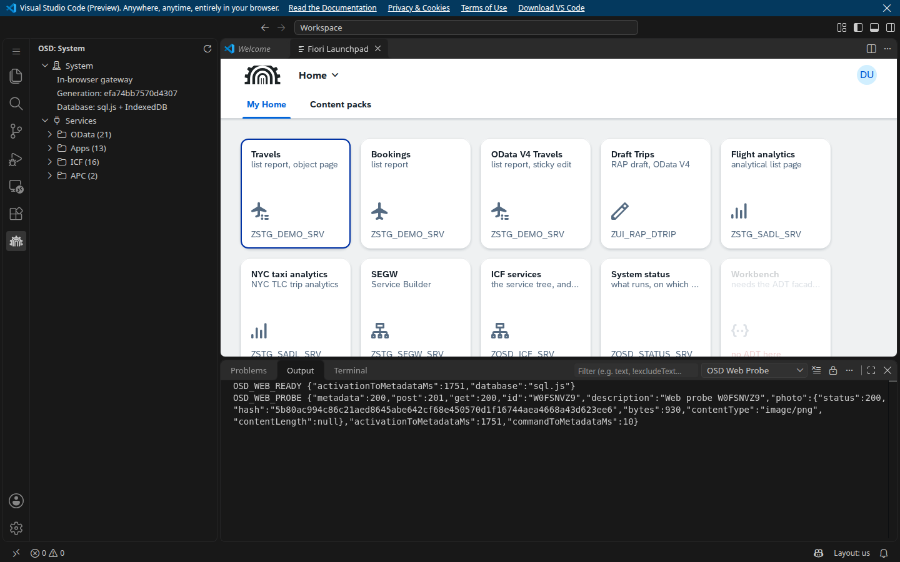
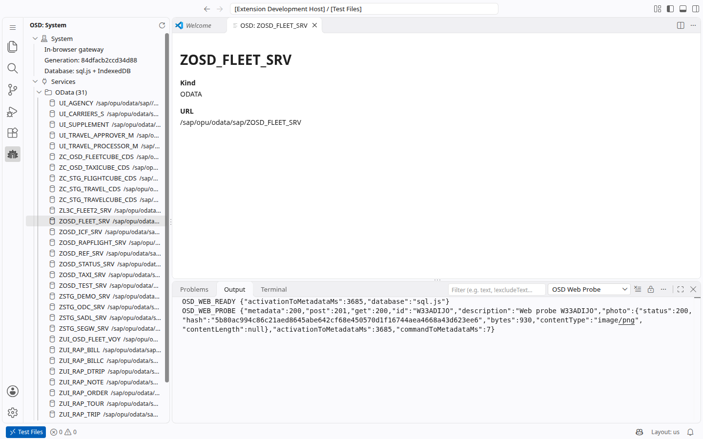
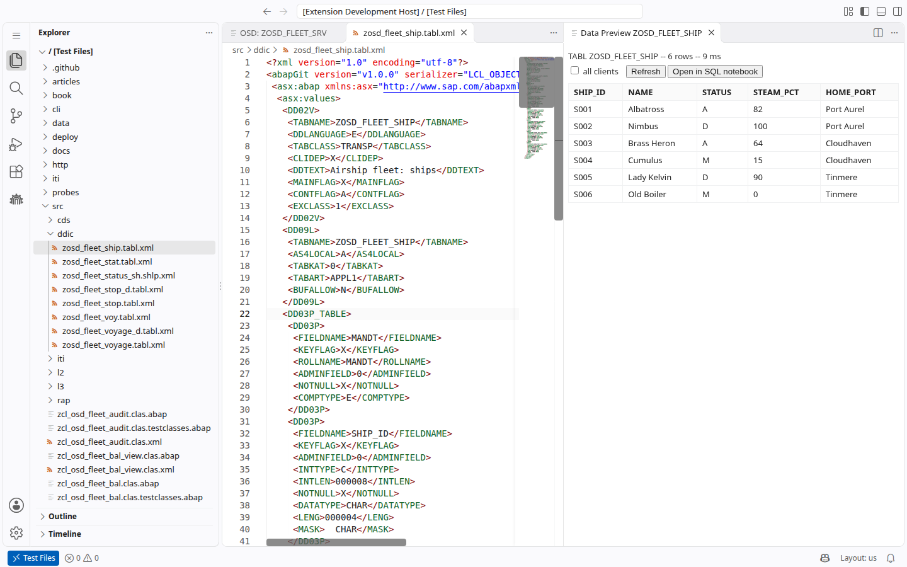
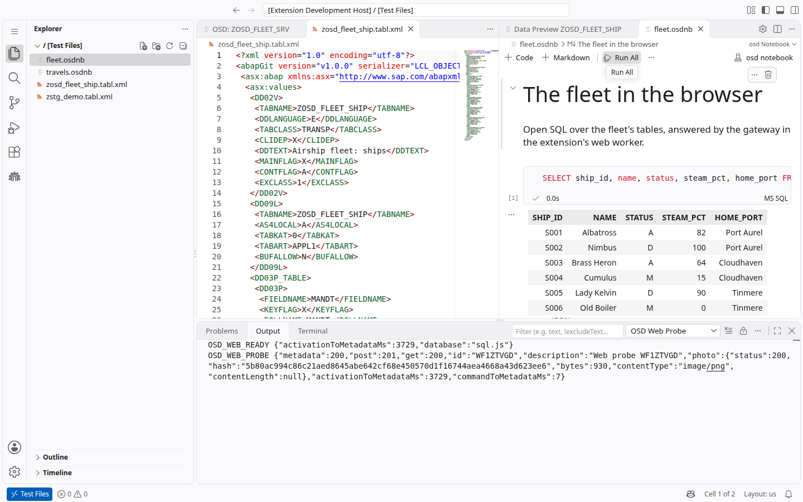
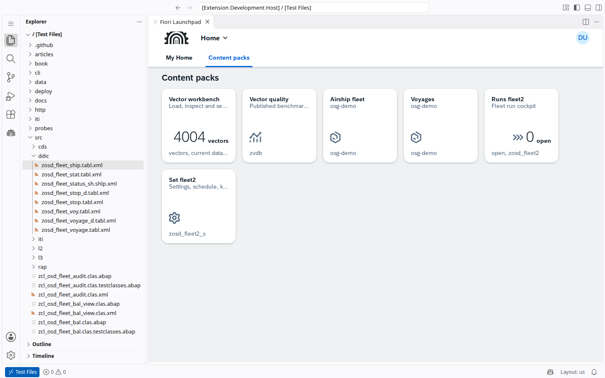
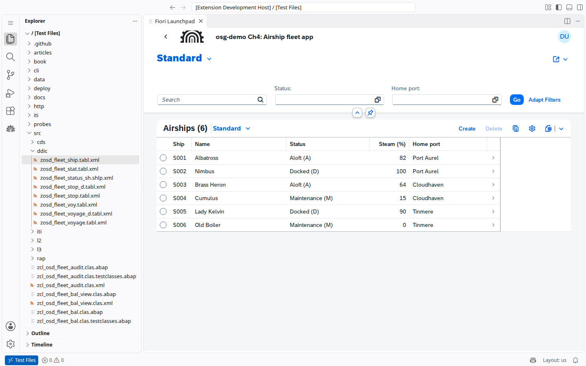
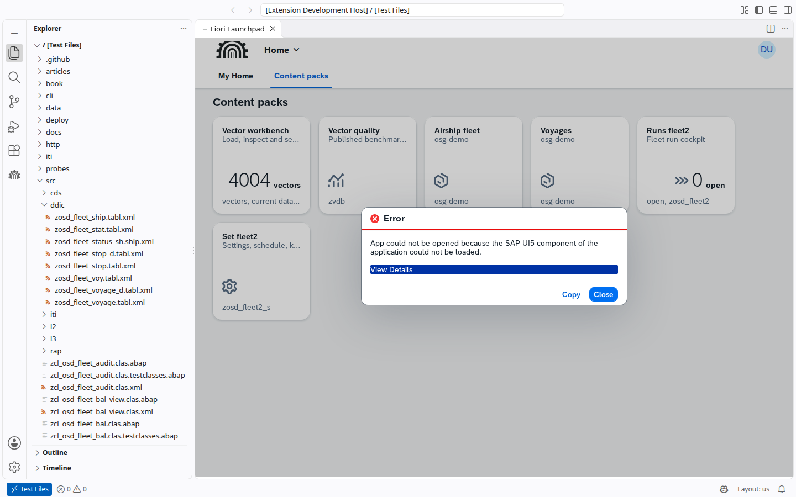
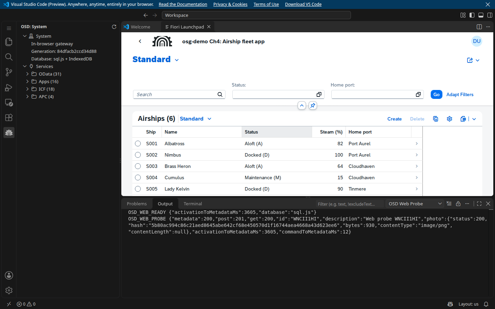

# 23. The fleet in a browser tab: vscode.dev

Every chapter so far has needed Node, a checkout of open-steamgate and a
port on your machine. VS Code also runs as a web page,
[vscode.dev](https://vscode.dev), and an extension can bring a part of
itself that runs there. open-steamgate's does: its browser entry carries the
gateway, already translated to JavaScript, and runs it in the extension's
web worker, with sql.js as the database and the browser's IndexedDB keeping
it between visits. No server is started and no port is opened: a request
from a Fiori app travels by message to the worker and comes back as an HTTP
answer
([docs/vscode-web.md](https://github.com/oisee/open-steamgate/blob/vscode-stable-v0.7.3140/docs/vscode-web.md)).

One thing does not fit in a browser tab: the transpiler. Nothing in the
browser turns ABAP into JavaScript, so it can run only a system that was
built before it got there. This chapter first opens open-steamgate's own
system in vscode.dev, then builds one with the fleet in it and brings that
in, and ends where the browser stops.

## Try it without installing anything

You need a Chromium-based browser; this chapter was walked in Chromium.

1. Open [vscode.dev](https://vscode.dev), the Extensions view, and search
   for `open-steamgate`. Press **Install**. Expected: two questions. The
   first asks whether you trust the publisher: **Trust Publisher &
   Install**. The second says the extension has limited functionality in
   VS Code for the Web: **Install Anyway**. A few seconds later the OSD
   icon is in the activity bar. No account is needed. (A welcome page may
   offer *Start with the defaults*; that command is for the desktop, close
   the page.)

2. Open the OSD view. Expected: **System** reads *In-browser gateway*, a
   generation, and *Database: sql.js + IndexedDB*; **Services** has OData
   (21), Apps (13), ICF (16) and APC (2). This is open-steamgate's own
   demo system, the one its Marketplace package was built with.

3. Press F1 and run **osd: Open Fiori Launchpad**. Expected: a launchpad
   in an editor tab, with the tiles of open-steamgate's demos: Travels,
   Bookings, Flight analytics, SEGW, System status and more. **Workbench**
   is grey (*needs the ADT facade*) and so is **AMDP sandbox** (*no
   SQLScript engine here*). Open **Travels**: a list report, with rows.

   

4. F1, **osd: Web probe**. Expected, in the output *OSD Web Probe*: a line
   `OSD_WEB_PROBE {"metadata":200,"post":201,"get":200,…}`: the worker read
   the service's metadata, created a travel and read it back. Reload the
   page (F1, **Developer: Reload Window**), then F1, **osd: Web verify last
   Travel**. Expected: the travel the probe created, read after the reload.
   The worker exported its database to IndexedDB before it answered the
   POST.

That is a working gateway in a browser tab, and it is open-steamgate's
system, not the fleet. The fleet needs a bundle of its own.

## Build the fleet into a bundle

The rest happens in the open-steamgate checkout at the book's tag, with
`npm ci && npm run bootstrap` done once, and this repository beside it.

5. Build the web extension with this repository as a pack:

   ```sh
   OSD_PACKS=$PWD/../osg-demo OSD_WEB_PACKS=all npm run web:vscode
   ```

   It transpiles the system with every pack it can see, writes the seed and
   the service tables, and bundles the worker. Expected, after four or five
   minutes: `Packs: o4d, zork, gui-examples, rap-flight, lsd, zvdb,
   travels-a4h, osg-demo`, `Status: 31 OData services, 16 apps, 8 packs`
   and `VS Code web bundle (all): raw 66925737 bytes (63.83 MiB), gzip
   7935668 bytes (7.57 MiB)`. `OSD_WEB_PACKS=osg-demo` alone is refused with
   `unknown pack: osg-demo`: at this tag the web build looks a named pack up
   only under the checkout's `packs/`; `all` takes the packs `OSD_PACKS`
   adds as well.

6. Open it in a local VS Code for the Web first, with this repository as
   its folder. `@vscode/test-web` drives its own Chromium, which its
   Playwright fetches once:

   ```sh
   npx -y playwright@1.65.1 install chromium
   npx -y @vscode/test-web --quality stable --browser chromium --extensionDevelopmentPath ./editors/vscode ../osg-demo
   ```

   Expected: VS Code for the Web is downloaded into `.vscode-test-web/` in
   the checkout (delete the folder afterwards), then a Chromium window
   with VS Code, the repository's files in the Explorer under the label
   `[Test Files]` (test-web names every folder so), and the OSD icon. Open the OSD view: OData (31) and Apps (16)
   now, with `ZOSD_FLEET_SRV` and `ZUI_OSD_FLEET_VOY` among the OData
   services. A click on `ZOSD_FLEET_SRV` shows its kind and URL.

   

7. Open `src/ddic/zosd_fleet_ship.tabl.xml` and press F8. Expected: *Data
   Preview ZOSD_FLEET_SHIP*, six rows, from Albatross to Old Boiler, as in
   chapter 1. Press **Open in SQL notebook** and answer the question whether
   you trust the notebook's authors with **Open Notebook**: a new notebook
   with `SELECT * FROM ZOSD_FLEET_SHIP WHERE MANDT = '123'` in a cell. Run
   it with the cell's Run button or Shift+Enter, and the table appears under
   the cell, with the client column `MANDT` that the preview leaves out. An
   ABAP cell would say that it is not available in the browser.

   

   

8. F1, **osd: Open Fiori Launchpad**, tab **Content packs**. Expected:
   **Airship fleet** and **Voyages**, both with the subtitle `osg-demo`.
   Open **Airship fleet**: chapter 4's list report, *Airships (6)*, with
   status and steam as in the seed.

   

   

9. Go back and open **Voyages**. Expected: an error, *App could not be
   opened because the SAP UI5 component of the application could not be
   loaded*. The last section says why.

   

## Bring it into vscode.dev

vscode.dev installs extensions from the Marketplace, and, through
**Developer: Install Extension From Location...**, from an address its
content security policy allows. That policy allows `https://localhost`, not
an arbitrary web server, so open-steamgate serves the bundle locally:

10. In the open-steamgate checkout:

    ```sh
    npm run web:vscode:stage
    npm run web:vscode:serve
    ```

    Expected: the staged extension under `build/preview/vscode-web`, then a
    server on `https://localhost:5000` with a certificate it made itself.
    Open `https://localhost:5000/` once in the browser and accept the
    certificate (or make one with `mkcert localhost` and name it with
    `OSD_WEB_CERT` and `OSD_WEB_KEY`).

11. In vscode.dev, F1, **Developer: Install Extension From Location...**,
    `https://localhost:5000`. The browser asks whether vscode.dev may reach
    the local network; the launchpad's tab, a page of its own, needs the
    same, so allow each time it asks. Expected: the OSD icon, and in the OSD
    view the same generation as in step 6. The launchpad and the Airship
    fleet app work as they did there. vscode.dev has no folder open now, so
    there is no table file for F8; step 7 is the place for that. (If the
    Marketplace extension from step 1 is installed, uninstall it first.)

    

When you are done, stop the server with Ctrl+C. The extension stays in
vscode.dev, but without the server it can no longer load; uninstall it
from the Extensions view.

## How a request gets there

A Fiori app in the launchpad tab is a page in a VS Code *webview*. Its
SAPUI5 comes from `ui5.sap.com` as everywhere else, its own files from the
extension. Before anything else runs in the page, the extension puts in a
script that replaces `XMLHttpRequest` and `fetch` with versions that look
at the address. A request to `…/sap/opu/odata/…` or `…/sap/bc/…` goes by
`postMessage` to the extension, which hands it to the gateway in the worker
and posts the answer back: status, headers and body, as an HTTP client
expects them. Every other address is the browser's own request, except
two small ones the page answers itself: the sandbox's configuration, and
the launchpad's question whether ADT is there (no, see below).

The gateway is the same ABAP as on the desktop, transpiled when the bundle
was built: the fleet's `ZCL_ZOSD_FLEET_DPC_EXT` answers chapter 4's list in
the browser as it does on port 8099. Every modifying request writes the
sql.js database to IndexedDB before its answer goes back, so a reload finds
what step 4 wrote. The stored database belongs to one build: a new bundle
starts from its own seed.

## What stays on the desktop

The browser entry sets a context key, and the extension's menus and
commands that need Node are hidden by it: **Start**, ABAP Unit and the
Testing view, the debugger, F9, Check and Activate, `.http` CodeLens, jobs,
and the HANA extract. ABAP and SQLScript notebook cells answer that they
are not available in the browser. The Workbench tile is grey because the
Workbench needs the Node host's ADT facade. The AMDP sandbox is grey
because it runs its bodies on HANA only; in the browser it is grey on
either database. With the setting
`osd.web.database` set to `duckdb`, a SQLScript notebook cell runs through
Portable AMDP on DuckDB-Wasm, but the database is then kept in memory and
reseeded on every reload.

## Where the browser stops

Chapter 21's voyages do not open, for two reasons, both in
open-steamgate's web entry at this tag:

- **OData V4 is not bridged.** The page's runtime sends only
  `/sap/opu/odata/` and `/sap/bc/` to the gateway; a Fiori Elements V4 app
  asks `/sap/opu/odata4/`, and that request goes to the webview's file
  server and gets `404`. open-steamgate's own V4 tiles, **OData V4 Travels**
  and **Draft Trips**, fail the same way in the Marketplace package.
- **A pack's BSP folders are not bundled.** The web build copies each
  pack's `webapp/`, not the folders its `bsp` names, so the Voyages
  component (`voyage/`, chapter 21) is not in the bundle at all. That is
  the error of step 9.

The voyages themselves are there: `ZUI_OSD_FLEET_VOY` is in the OSD view,
and its V2 binding answers with the three seeded voyages. But the draft
round trip of chapter 21 needs the V4 app, and so the desktop.

Two more things to know at this tag:

- **Install from the Marketplace or from your own build, not from the
  release page.** The universal `open-steamgate-0.7.3140.vsix` attached to
  the GitHub release declares a browser entry but does not contain it; the
  Marketplace package of the same version does.
- **Building ABAP stays on the desktop.** Change a class, and the browser
  cannot show the change until step 5 is run again on a machine with Node.

## The checks

`test/web-shots.mjs` repeats steps 6 to 9 in `@vscode/test-web` with
Playwright and takes this chapter's pictures: activation and the worker's
first `$metadata`, the OSD view, F8, a notebook cell, the launchpad tiles,
the Airship fleet list, a write through `ZOSD_FLEET_SRV` that survives a
reload, the greyed tiles, Zork and the WEBGUI. It records the V4 steps as
known failures of this tag. `test/web-vscodedev.mjs` installs into the real
vscode.dev, from the Marketplace or from a `https://localhost` address,
without an account, and checks the OSD view, the probe and the launchpad.
`test/web-shots.mjs` and the `location` route need a web bundle built as
in step 5; the `marketplace` route needs only an open-steamgate checkout
for its Playwright. All need a network; none is part of CI.
