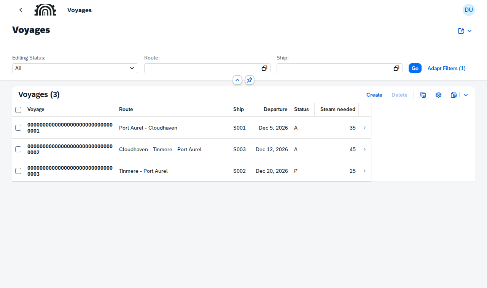
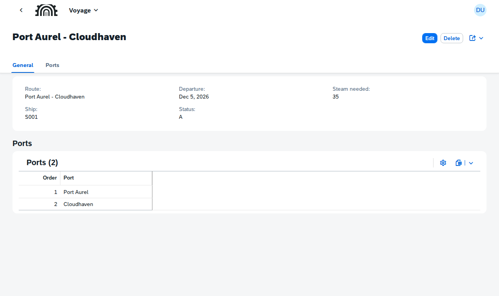
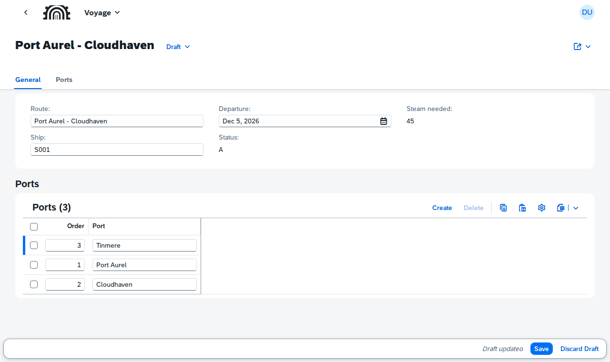

# 21. Рейсы как бизнес-объект: RAP

В главах 3–5 служба флота строилась классическим способом. Файл YAML описывал
модель OData, написанный вручную `DPC_EXT` заполнял то, чего модель не могла,
а представления CDS добавили куб. Более новая модель ABAP, ABAP RESTful
Application Programming Model (RAP), описывает *бизнес-объект* один раз.
Представления CDS задают его форму. Определение поведения говорит, что с ним
может происходить. Пул поведения, обычный ABAP, хранит правила. Остальное
делает фреймворк: транзакционный буфер, черновики, блокировки, ETag и службу
OData V4, с которой разговаривает приложение Fiori Elements.

open-steamgate исполняет управляемый (managed) RAP. Он читает определение
поведения, генерирует типы, которые нужны операторам, держит экземпляры в
буфере, пока последовательность сохранения не запишет их, и отдаёт определение
службы по OData V2 и V4
([docs/rap-runtime.md](https://github.com/oisee/open-steamgate/blob/vscode-stable-v0.7.3140/docs/rap-runtime.md)).
EML, операторы `MODIFY ENTITIES`, `READ ENTITIES`, `COMMIT ENTITIES` и
`ROLLBACK ENTITIES`, транспайлер переводит в вызовы этой среды выполнения
([docs/rap-eml.md](https://github.com/oisee/open-steamgate/blob/vscode-stable-v0.7.3140/docs/rap-eml.md)).

В этой главе у флота появляется свой объект RAP: **рейсы**, каждый с портами,
в которые он заходит. Исходники лежат в [src/rap/](../../src/rap/); всё, что
описано ниже, проверяет `test/rap.mjs` (приложение A).

## Спланируйте рейс

Система запущена, как в главе 1. В URL предполагается порт 8099.

1. Откройте панель запуска и плитку **Voyages**. Ожидается: отчёт-список
   с тремя рейсами: S001 *Port Aurel - Cloudhaven*, статус `A`, нужно 35
   единиц пара; S003 *Cloudhaven - Tinmere - Port Aurel*, `A`, 45; S002
   *Tinmere - Port Aurel*, `P`, 25. Первый столбец — ключ рейса, UUID;
   статус показан кодом.

   

2. Откройте рейс S001. Ожидается: его объектная страница с разделами
   **General** (маршрут, корабль, вылет, статус, нужный пар) и **Ports**:
   Port Aurel и Cloudhaven. Чтобы поднять корабль, рейсу нужно 15 единиц пара,
   и ещё по 10 на каждый порт захода, поэтому два порта дают 35.

   

3. Нажмите **Edit**. В разделе **Ports** нажмите **Create**, замените порядок
   `0` на `3`, введите порт `Tinmere` и уйдите с поля. Ожидается: **Draft** рядом с
   заголовком, новая строка вверху таблицы и нужный пар 45. Пока ничего не
   сохранено: вы правите *черновик*, копию рейса, которая живёт рядом с
   активной, пока вы её не сохраните или не отбросите. Нажмите **Discard
   Draft** и подтвердите: рейс остался прежним, с двумя портами и 35.

   

4. Вернитесь к списку и нажмите **Create**. Ожидается: страница *New:
   Voyage*, уже со статусом `P` и паром 15. Введите маршрут и корабль
   `S005`, добавьте один порт, как в шаге 3, и нажмите **Create** внизу
   страницы (у нового объекта нет Save). Ожидается: *Object created*,
   статус `P` (запланирован), нужный пар 25.
5. Запланируйте рейс для корабля, которого во флоте нет: **Create**, маршрут
   `Nowhere`, корабль `S999` и **Create** внизу страницы. Ожидается: окно
   ошибки с `Ship S999 is not in the fleet` (дважды: от Prepare и от
   Activate). Закройте его и нажмите **Discard Draft**: нового рейса в
   списке нет. Пока черновик не отброшен, список показывает отклонённый
   рейс строкой черновика.
6. Одобрите запланированный рейс S002. Кнопки для этого в приложении нет, а
   действие у службы есть:

   ```
   B=http://localhost:8099/sap/opu/odata4/sap/ZUI_OSD_FLEET_VOY
   T=$(curl -s -c jar -D - -o /dev/null -H "x-csrf-token: fetch" "$B/" | grep -i '^x-csrf-token' | tr -d '\r' | cut -d' ' -f2)
   curl -s -b jar -X POST -H "x-csrf-token: $T" -H "Content-Type: application/json" -H "If-Match: *" -d '{}' \
     "$B/Voyage(voyage_uuid='00000000000000000000000000000003',IsActiveEntity=true)/ZUI_OSD_FLEET_VOY.Approve"
   ```

   Ожидается: рейс возвращается в JSON с `"status":"A"`. Обновите список:
   рейс S002 одобрен.
7. Модель службы: `$B/$metadata`. Ожидается: `VoyageType` и `StopType`,
   у каждого ключ из UUID и `IsActiveEntity`; связанные действия `Edit`,
   `Activate`, `Prepare`, `Resume`, `Approve` и `Cancel`; и
   `Common.DraftRoot` на наборе `Voyage`. Действия `Discard` нет: в OData V4
   черновик отбрасывают запросом DELETE.

Данные берутся из начального заполнения в `data/`, которое при каждом старте
заменяет строки, как в главе 3.

## Объект

Форму задают два представления CDS. Корень, рейс, владеет своими остановками
через композицию:

<!-- code: src/rap/zi_osd_fleet_voyage.ddls.asddls -->
```
@AccessControl.authorizationCheck: #NOT_REQUIRED
@EndUserText.label: 'Airship fleet: voyages as a RAP business object'
define root view entity ZI_OSD_FLEET_VOYAGE as select from zosd_fleet_voyage
  composition [0..*] of ZI_OSD_FLEET_STOP as _Stops
{
  key voyage_uuid,
      ship_id,
      route,
      dep_date,
      status,
      steam_needed,
      @Semantics.systemDateTime.lastChangedAt: true
      last_changed_at,
      @Semantics.systemDateTime.localInstanceLastChangedAt: true
      local_changed_at,
      _Stops
}
```

Определение поведения хранит весь объект в одном файле. Его часть для
рейса:

<!-- code: src/rap/zi_osd_fleet_voyage.bdef.asbdef lines 1-36 -->
```
managed implementation in class zbp_osd_fleet_voyage unique;
strict ( 2 );
with draft;

define behavior for ZI_OSD_FLEET_VOYAGE alias Voyage
persistent table zosd_fleet_voyage
draft table zosd_fleet_voyage_d
lock master
total etag last_changed_at
etag master local_changed_at
{
  create;
  update;
  delete;
  field ( numbering : managed, readonly ) voyage_uuid;
  field ( readonly ) status, steam_needed, last_changed_at, local_changed_at;
  field ( mandatory ) route;
  association _Stops { create; with draft; }
  determination SetPlanned on modify { create; }
  determination CalcSteam on modify { create; }
  internal action RecalcSteam;
  validation CheckShip on save { create; field ship_id; }
  action Approve result [1] $self;
  action Cancel result [1] $self;

  draft action Edit;
  draft action Activate optimized;
  draft action Discard;
  draft action Resume;
  draft determine action Prepare
  {
    validation CheckShip;
  }

  mapping for zosd_fleet_voyage corresponding;
}
```

Прочтите его сверху вниз:

- `managed`: таблицы пишет фреймворк, пул только добавляет правила.
  `with draft` даёт каждому рейсу таблицу черновиков рядом с активной, а
  действия черновика — это то, что приложение вызывало в шагах 3–5: `Edit`,
  `Prepare` и `Activate`, а ещё `Discard`, который доходит до службы как
  DELETE черновика. `Resume` продолжает черновик, оставленный раньше.
- `numbering : managed`: ключ — UUID, который выдаёт фреймворк.
- `total etag` и `etag master`: оптимистическая блокировка, и для черновика,
  и для активного рейса.
- `field ( readonly )` на `status` и `steam_needed`: приложение не может их
  задать. Может только пул, через EML в локальном режиме.
- Две детерминации, одно внутреннее действие, одна валидация и два действия:
  правила ниже.

Определение остановки короче: её блокирует рейс (`lock dependent by
_Voyage`), и у неё есть своя детерминация, `RecalcVoyageSteam`, о которой
речь пойдёт ниже.

Определение службы открывает обе сущности:

<!-- code: src/rap/zui_osd_fleet_voy.srvd.srvdsrv -->
```
@EndUserText.label: 'Airship fleet: voyage service'
define service ZUI_OSD_FLEET_VOY {
  expose ZI_OSD_FLEET_VOYAGE as Voyage;
  expose ZI_OSD_FLEET_STOP as Stop;
}
```

## Правила

Пул поведения `ZBP_OSD_FLEET_VOYAGE` объявляет обработчики так же, как на
системе. Каждое объявление называет правило, которое оно реализует; имя
метода произвольное:

<!-- code: src/rap/zbp_osd_fleet_voyage.clas.locals_imp.abap lines 26-40 -->
```abap
CLASS lhc_voyage DEFINITION INHERITING FROM cl_abap_behavior_handler FINAL.
  PRIVATE SECTION.
    METHODS set_planned FOR DETERMINE ON MODIFY
      IMPORTING keys FOR Voyage~SetPlanned.
    METHODS calc_steam FOR DETERMINE ON MODIFY
      IMPORTING keys FOR Voyage~CalcSteam.
    METHODS recalc_steam FOR MODIFY
      IMPORTING keys FOR ACTION Voyage~RecalcSteam.
    METHODS check_ship FOR VALIDATE ON SAVE
      IMPORTING keys FOR Voyage~CheckShip.
    METHODS approve FOR MODIFY
      IMPORTING keys FOR ACTION Voyage~Approve RESULT result.
    METHODS cancel FOR MODIFY
      IMPORTING keys FOR ACTION Voyage~Cancel RESULT result.
ENDCLASS.
```

Обработчик получает ключи экземпляров, а не сами экземпляры. Он читает и
меняет их через EML в локальном режиме, в котором можно задавать поля только
для чтения. Новый рейс начинается как запланированный:

<!-- code: src/rap/zbp_osd_fleet_voyage.clas.locals_imp.abap method set_planned -->
```abap
  METHOD set_planned.
* a new voyage starts as P (planned)
    DATA lt_read    TYPE TABLE FOR READ IMPORT zi_osd_fleet_voyage.
    DATA ls_read    LIKE LINE OF lt_read.
    DATA lt_voyages TYPE TABLE FOR READ RESULT zi_osd_fleet_voyage.
    DATA ls_voyage  LIKE LINE OF lt_voyages.
    DATA lt_update  TYPE TABLE FOR UPDATE zi_osd_fleet_voyage.
    DATA ls_update  LIKE LINE OF lt_update.
    DATA ls_key     LIKE LINE OF keys.

    LOOP AT keys INTO ls_key.
      CLEAR ls_read.
      ls_read-%tky = ls_key-%tky.
      APPEND ls_read TO lt_read.
    ENDLOOP.
    READ ENTITIES OF zi_osd_fleet_voyage IN LOCAL MODE
      ENTITY Voyage
        FIELDS ( status ) WITH lt_read
      RESULT lt_voyages.
    LOOP AT lt_voyages INTO ls_voyage WHERE status IS INITIAL.
      CLEAR ls_update.
      ls_update-%tky = ls_voyage-%tky.
      ls_update-status = 'P'.
      APPEND ls_update TO lt_update.
    ENDLOOP.
    IF lt_update IS INITIAL.
      RETURN.
    ENDIF.
    MODIFY ENTITIES OF zi_osd_fleet_voyage IN LOCAL MODE
      ENTITY Voyage
        UPDATE FIELDS ( status ) WITH lt_update
      REPORTED reported.
  ENDMETHOD.
```

Расчёт пара собран в одном месте, во внутреннем действии `RecalcSteam`.
Детерминация рейса `CalcSteam` выполняет его, когда рейс создан. Детерминация остановки `RecalcVoyageSteam` выполняет его для
рейса над ней, когда остановку создают или меняют. Так новый порт в шаге 3
изменил пар черновика. Действие считает остановки через композицию:

<!-- code: src/rap/zbp_osd_fleet_voyage.clas.locals_imp.abap method recalc_steam -->
```abap
  METHOD recalc_steam.
* steam needed: 15 to raise the ship, 10 per port the voyage calls at.
* The stops are read through the composition, so the rule counts the ports
* of the draft while it is a draft and of the active voyage once saved
    DATA lt_read  TYPE TABLE FOR READ IMPORT zi_osd_fleet_voyage\_Stops.
    DATA ls_read  LIKE LINE OF lt_read.
    DATA lt_stops TYPE TABLE FOR READ RESULT zi_osd_fleet_voyage\_Stops.
    DATA ls_stop  LIKE LINE OF lt_stops.
    DATA lt_link  TYPE TABLE FOR READ LINK zi_osd_fleet_voyage\_Stops.
    DATA ls_link  LIKE LINE OF lt_link.
    DATA lt_update TYPE TABLE FOR UPDATE zi_osd_fleet_voyage.
    DATA ls_update LIKE LINE OF lt_update.
    DATA ls_failed TYPE RESPONSE FOR FAILED EARLY zi_osd_fleet_voyage.
    DATA ls_key    LIKE LINE OF keys.

    LOOP AT keys INTO ls_key.
      CLEAR ls_read.
      ls_read-%tky = ls_key-%tky.
      APPEND ls_read TO lt_read.
    ENDLOOP.
* READ ENTITIES OF zi_osd_fleet_voyage IN LOCAL MODE
*   ENTITY Voyage BY \_Stops FROM lt_read
*   RESULT lt_stops LINK lt_link.
    zcl_osd_rap_eml=>read_by( EXPORTING iv_bdef   = 'ZI_OSD_FLEET_VOYAGE'
                                        iv_entity = 'VOYAGE'
                                        iv_assoc  = '_STOPS'
                                        it_keys   = lt_read
                              CHANGING  ct_result = lt_stops
                                        ct_link   = lt_link
                                        cs_failed = ls_failed ).
    LOOP AT lt_read INTO ls_read.
      CLEAR ls_update.
      ls_update-%tky = ls_read-%tky.
      LOOP AT lt_link INTO ls_link.
        IF ls_link-source-voyage_uuid <> ls_read-voyage_uuid
            OR ls_link-source-%is_draft <> ls_read-%is_draft.
          CONTINUE.
        ENDIF.
        LOOP AT lt_stops INTO ls_stop WHERE stop_uuid = ls_link-target-stop_uuid.
          ls_update-steam_needed = ls_update-steam_needed + 10.
        ENDLOOP.
      ENDLOOP.
      ls_update-steam_needed = ls_update-steam_needed + 15.
      APPEND ls_update TO lt_update.
    ENDLOOP.
    IF lt_update IS INITIAL.
      RETURN.
    ENDIF.
    MODIFY ENTITIES OF zi_osd_fleet_voyage IN LOCAL MODE
      ENTITY Voyage
        UPDATE FIELDS ( steam_needed ) WITH lt_update
      REPORTED reported.
  ENDMETHOD.
```

Один оператор здесь не записан как EML: `READ ENTITIES ... BY \_Stops`.
Транспайлер на этом теге пока не переводит оператор EML через ассоциацию,
поэтому он стоит в виде вызова среды выполнения, в который переводился бы,
а сам оператор — в комментарии над ним. Второе такое место —
`CREATE BY \_Stops` в классе EML ниже.

Валидация работает при сохранении и в `Prepare`. Она записывает экземпляр в
`failed` и сообщает об ошибке на поле:

<!-- code: src/rap/zbp_osd_fleet_voyage.clas.locals_imp.abap method check_ship -->
```abap
  METHOD check_ship.
* the ship must be one of the fleet's
    DATA lt_read     TYPE TABLE FOR READ IMPORT zi_osd_fleet_voyage.
    DATA ls_read     LIKE LINE OF lt_read.
    DATA lt_voyages  TYPE TABLE FOR READ RESULT zi_osd_fleet_voyage.
    DATA ls_voyage   LIKE LINE OF lt_voyages.
    DATA ls_failed   LIKE LINE OF failed-voyage.
    DATA ls_reported LIKE LINE OF reported-voyage.
    DATA lv_ship     TYPE zosd_fleet_ship-ship_id.
    DATA ls_key      LIKE LINE OF keys.

    LOOP AT keys INTO ls_key.
      CLEAR ls_read.
      ls_read-%tky = ls_key-%tky.
      APPEND ls_read TO lt_read.
    ENDLOOP.
    READ ENTITIES OF zi_osd_fleet_voyage IN LOCAL MODE
      ENTITY Voyage
        FIELDS ( ship_id ) WITH lt_read
      RESULT lt_voyages
      FAILED failed.
    LOOP AT lt_voyages INTO ls_voyage.
      IF ls_voyage-ship_id IS INITIAL.
        CLEAR: ls_failed, ls_reported.
        ls_failed-%tky = ls_voyage-%tky.
        APPEND ls_failed TO failed-voyage.
        ls_reported-%tky = ls_voyage-%tky.
        ls_reported-%msg = new_message_with_text(
          severity = if_abap_behv_message=>severity-error
          text     = 'A voyage needs one of the fleet''s ships' ).
        ls_reported-%element-ship_id = if_abap_behv=>mk-on.
        APPEND ls_reported TO reported-voyage.
        CONTINUE.
      ENDIF.
      SELECT SINGLE ship_id FROM zosd_fleet_ship INTO lv_ship
             WHERE ship_id = @ls_voyage-ship_id.
      IF sy-subrc <> 0.
        CLEAR: ls_failed, ls_reported.
        ls_failed-%tky = ls_voyage-%tky.
        APPEND ls_failed TO failed-voyage.
        ls_reported-%tky = ls_voyage-%tky.
        ls_reported-%msg = new_message_with_text(
          severity = if_abap_behv_message=>severity-error
          text     = |Ship { ls_voyage-ship_id } is not in the fleet| ).
        ls_reported-%element-ship_id = if_abap_behv=>mk-on.
        APPEND ls_reported TO reported-voyage.
      ENDIF.
    ENDLOOP.
  ENDMETHOD.
```

Это сообщение показал шаг 5. `Approve` ставит `A`, отказывает отменённому
рейсу и возвращает сам рейс (`result [1] $self`): это тот JSON, который
напечатал шаг 6.

## EML снаружи

Тем же объектом можно управлять из любого ABAP, а не только из приложения.
`ZCL_OSD_FLEET_VOYAGE_EML` оборачивает по одному оператору в метод;
`CREATE BY \_Stops` в `add_stop` записан как вызов, как и чтение выше. Черновик
создаётся с ключом, который выдаёт управляемая нумерация:

<!-- code: src/rap/zcl_osd_fleet_voyage_eml.clas.abap method create_draft -->
```abap
METHOD create_draft.
  DATA lt_create   TYPE tt_create.
  DATA ls_create   LIKE LINE OF lt_create.
  DATA ls_mapped   TYPE ty_mapped.
  DATA ls_failed   TYPE ty_failed.
  DATA ls_reported TYPE ty_reported.
  DATA ls_key      LIKE LINE OF ls_mapped-voyage.

  ls_create-%is_draft = if_abap_behv=>mk-on.
  ls_create-ship_id = iv_ship.
  ls_create-route = iv_route.
  APPEND ls_create TO lt_create.
  MODIFY ENTITIES OF zi_osd_fleet_voyage ENTITY Voyage
    CREATE AUTO FILL CID FIELDS ( ship_id route ) WITH lt_create
    MAPPED ls_mapped FAILED ls_failed REPORTED ls_reported.
  READ TABLE ls_mapped-voyage INDEX 1 INTO ls_key.
  IF sy-subrc = 0.
    rv_uuid = ls_key-voyage_uuid.
  ENDIF.
ENDMETHOD.
```

Активация и фиксация транзакции выглядят так:

<!-- code: src/rap/zcl_osd_fleet_voyage_eml.clas.abap method activate -->
```abap
METHOD activate.
  DATA lt_activate TYPE tt_activate.
  DATA ls_activate LIKE LINE OF lt_activate.
  DATA ls_mapped   TYPE ty_mapped.
  DATA ls_failed   TYPE ty_failed.
  DATA ls_reported TYPE ty_reported.

  ls_activate-voyage_uuid = iv_uuid.
  ls_activate-%is_draft = if_abap_behv=>mk-on.
  APPEND ls_activate TO lt_activate.
  MODIFY ENTITIES OF zi_osd_fleet_voyage ENTITY Voyage
    EXECUTE Activate FROM lt_activate
    MAPPED ls_mapped FAILED ls_failed REPORTED ls_reported.
  IF ls_failed-voyage IS INITIAL.
    rv_ok = abap_true.
  ENDIF.
ENDMETHOD.
```

<!-- code: src/rap/zcl_osd_fleet_voyage_eml.clas.abap method save -->
```abap
METHOD save.
  CLEAR: es_failed, es_reported.
  COMMIT ENTITIES RESPONSE OF zi_osd_fleet_voyage
    FAILED es_failed REPORTED es_reported.
  IF sy-subrc = 0.
    rv_saved = abap_true.
  ENDIF.
ENDMETHOD.
```

Его тест ABAP Unit проигрывает всю историю: черновик с двумя портами,
детерминации, Activate, `COMMIT ENTITIES`, Approve; корабль, которого во
флоте нет, где валидация останавливает фиксацию и ничего не записывается; и
отменённый рейс, который нельзя одобрить. Из клона open-steamgate:

```
OSD_PACKS=/path/to/osg-demo npm run transpile
OSD_PACKS=/path/to/osg-demo node tools/osd-unit.mjs CLAS ZCL_OSD_FLEET_VOYAGE_EML
```

Ожидается: `ZCL_OSD_FLEET_VOYAGE_EML: 3 methods in 1 test classes, 3 passed, 0 failed`
и время прогона.
Удачный путь:

<!-- code: src/rap/zcl_osd_fleet_voyage_eml.clas.testclasses.abap method draft_stops_activate_approve -->
```abap
  METHOD draft_stops_activate_approve.
    DATA lv_uuid   TYPE zosd_fleet_voyage-voyage_uuid.
    DATA ls_voyage TYPE zcl_osd_fleet_voyage_eml=>ty_voyage.

* a draft for a ship of the fleet, with two ports it calls at
    lv_uuid = mo_voyages->create_draft( iv_ship = 'S001' iv_route = 'Port Aurel - Cloudhaven' ).
    cl_abap_unit_assert=>assert_not_initial( act = lv_uuid msg = 'the create maps a key' ).
    cl_abap_unit_assert=>assert_true( act = mo_voyages->add_stop( iv_uuid = lv_uuid iv_port = 'Port Aurel' iv_order = 1 )
                                       msg = 'a stop is created by the composition' ).
    cl_abap_unit_assert=>assert_true( act = mo_voyages->add_stop( iv_uuid = lv_uuid iv_port = 'Cloudhaven' iv_order = 2 ) ).

* the draft carries the determinations' fields, and nothing is written yet
    ls_voyage = mo_voyages->read_voyage( iv_uuid = lv_uuid iv_draft = abap_true ).
    cl_abap_unit_assert=>assert_equals( act = ls_voyage-status exp = 'P' msg = 'SetPlanned ran' ).
    cl_abap_unit_assert=>assert_equals( act = ls_voyage-steam_needed exp = 35
                      msg = '15 to raise the ship, 10 per port: two ports' ).
    cl_abap_unit_assert=>assert_equals( act = db_count( iv_table = 'vosd_fleet_voyage_d' iv_uuid = lv_uuid ) exp = 0
                      msg = 'a draft stays in the buffer until COMMIT ENTITIES' ).

* Activate, then COMMIT ENTITIES: the active voyage, its stops with it
    cl_abap_unit_assert=>assert_true( act = mo_voyages->activate( lv_uuid ) msg = 'Activate ran' ).
    cl_abap_unit_assert=>assert_true( act = mo_voyages->save( ) msg = 'COMMIT ENTITIES saved' ).
    APPEND lv_uuid TO mt_uuid.
    ls_voyage = mo_voyages->read_voyage( iv_uuid = lv_uuid iv_draft = abap_false ).
    cl_abap_unit_assert=>assert_equals( act = ls_voyage-ship_id exp = 'S001' ).
    cl_abap_unit_assert=>assert_equals( act = ls_voyage-steam_needed exp = 35 msg = 'the steam went with it' ).
    cl_abap_unit_assert=>assert_equals( act = db_count( iv_table = 'vosd_fleet_stop' iv_uuid = lv_uuid ) exp = 2 ).
    cl_abap_unit_assert=>assert_equals( act = db_count( iv_table = 'vosd_fleet_voyage_d' iv_uuid = lv_uuid ) exp = 0
                      msg = 'the draft is gone' ).

* Approve answers the voyage itself, with the status it set
    cl_abap_unit_assert=>assert_equals( act = mo_voyages->approve( lv_uuid ) exp = 'A' msg = 'EXECUTE answers the RESULT' ).
    cl_abap_unit_assert=>assert_true( act = mo_voyages->save( ) ).
    ls_voyage = mo_voyages->read_voyage( iv_uuid = lv_uuid iv_draft = abap_false ).
    cl_abap_unit_assert=>assert_equals( act = ls_voyage-status exp = 'A' ).
  ENDMETHOD.
```

## Приложение

Приложение Voyages в [voyage/](../../voyage/) — это отчёт-список и
объектная страница Fiori Elements V4. Кода для черновиков в нём нет вовсе.
Fiori Elements читает `Common.DraftRoot` из модели службы и сам ведёт
черновик: Edit, PATCH на каждое изменённое поле, а при Save — Prepare и
Activate. Пак регистрирует приложение рядом с приложением флота из главы 4,
с интентом и плиткой:

<!-- code: osd-pack.json -->
```json
{
  "name": "osg-demo",
  "description": "Guided ABAP demo for open-steamgate",
  "package": "$ZOSD_DEMO",
  "order": 100,
  "osd": ">=0.7.3140",
  "abap": "src",
  "bsp": {
    "ZOSD_VOYAGE4": "voyage"
  },
  "intents": {
    "Voyage-manage": {"app": "ZOSD_VOYAGE4", "component": "osd.voyage", "title": "Voyages"}
  },
  "tiles": [
    {
      "id": "osg-demo-fleet",
      "title": "Airship fleet",
      "subtitle": "osg-demo",
      "url": "/app/flp.html#AirshipFleet-display"
    },
    {
      "id": "osg-demo-voyage",
      "title": "Voyages",
      "subtitle": "osg-demo",
      "url": "/app/flp.html#Voyage-manage"
    }
  ]
}
```

Одно приложению нужно сказать явно. Когда меняется порт, сервер сразу
пересчитывает пар рейса в черновике, но Fiori Elements перечитывает только
то, о чём знает, что оно зависит от изменения. Об этом говорит побочный
эффект (side effect) в аннотациях приложения:

<!-- code: voyage/annotations/annotations.xml lines 34-39 -->
```xml
<Annotation Term="Common.SideEffects" Qualifier="Stops">
  <Record Type="Common.SideEffectsType">
    <PropertyValue Property="SourceEntities"><Collection><NavigationPropertyPath>to_Stops</NavigationPropertyPath></Collection></PropertyValue>
    <PropertyValue Property="TargetProperties"><Collection><String>steam_needed</String></Collection></PropertyValue>
  </Record>
</Annotation>
```

С ним уход с поля порта отправляет изменение и чтение `steam_needed` в одном
пакете, и появляется 45 из шага 3. Без него страница показывает 35, пока её не
перезагрузят, а ETag рейса, который детерминация тоже сдвинула, устаревает:
следующее сохранение сначала получает отказ 412 `If-Match does not match the
current ETag of the entity`, приложение читает новый тег и пробует снова.
Побочный эффект приносит свежий тег вместе с паром.

## Чего эта среда выполнения не делает

- **Удалённый порт не пересчитывает рейс.** Среда выполнения не запускает
  детерминацию по триггеру удаления, поэтому определение поведения объявляет
  у остановки только `create` и `update`. Удалите порт во время правки: пар
  останется прежним, пока его не пересчитает другое изменение.
- **EML через ассоциацию** (`CREATE BY \_Stops`, `READ ... BY \_Stops`)
  транспайлер на этом теге не переводит. Пул и класс EML записывают эти два
  оператора как вызовы, в которые они переводятся.
- **Служба с аннотациями и именем длиннее 18 символов** на этом теге не
  собирается: один из её сгенерированных классов не сокращается. Поэтому
  служба называется `ZUI_OSD_FLEET_VOY`, а не длиннее.
- **На систему переезжает только модель данных.** Zip из приложения B везёт
  четыре таблицы и два представления. Определение поведения, определение
  службы и приложение Voyages остаются локальными: инструмент упаковки на
  этом теге не знает типов файлов abapGit для первых двух и не сериализует
  второе приложение пака. Пул и класс EML остаются вместе с ними: на системе
  их нельзя активировать без определения поведения.
- **Activate и валидация.** В этой среде выполнения `Activate` черновика
  через EML проходит, а валидация останавливает следующий за ним
  `COMMIT ENTITIES`; это и проверяет юнит-тест. По OData первым отказывает
  `Prepare` приложения, как показал шаг 5.

## Собственный сценарий SAP с полётами

Объект флота нарочно маленький. Чтобы показать, как далеко заходит среда
выполнения, open-steamgate забирает публичный эталонный сценарий RAP от SAP,
[abap-platform-refscen-flight](https://github.com/SAP-samples/abap-platform-refscen-flight)
(Apache-2.0), как пак и исполняет его. На этом теге работают управляемое
путешествие с бронированиями, объекты доплат и агентств с черновиками,
интерфейсное определение поведения агентства и синглтон перевозчика: все
определения поведения из сценария, которые пак берёт. Отдельные варианты
сценария — с черновиками, с совместными черновиками, неуправляемый и
иерархический — пак не забирает. Что
работает и что отклонено, конструкция за конструкцией, перечислено в записи:
[docs/rap-flight-pack.md](https://github.com/oisee/open-steamgate/blob/vscode-stable-v0.7.3140/docs/rap-flight-pack.md).
