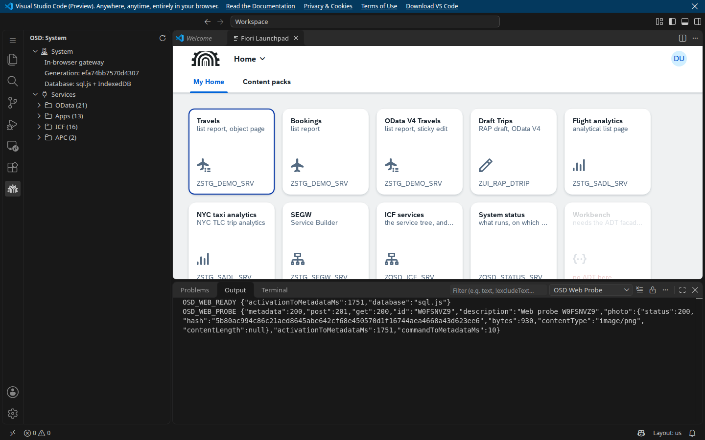
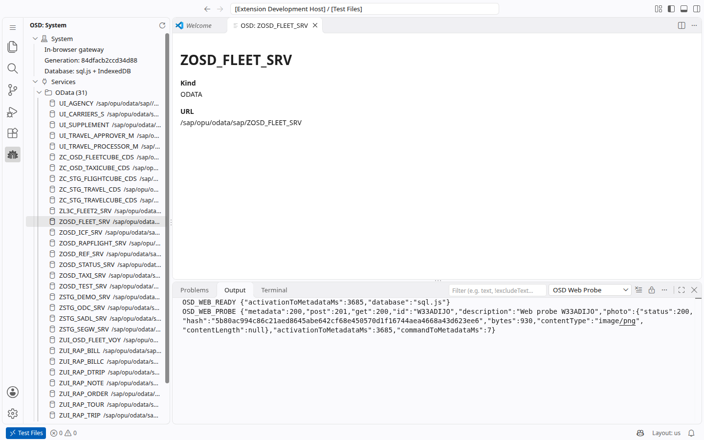
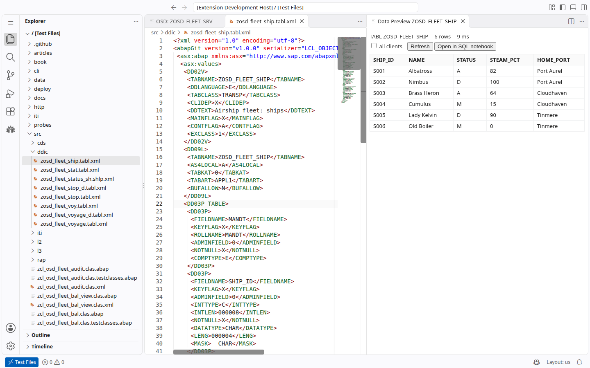
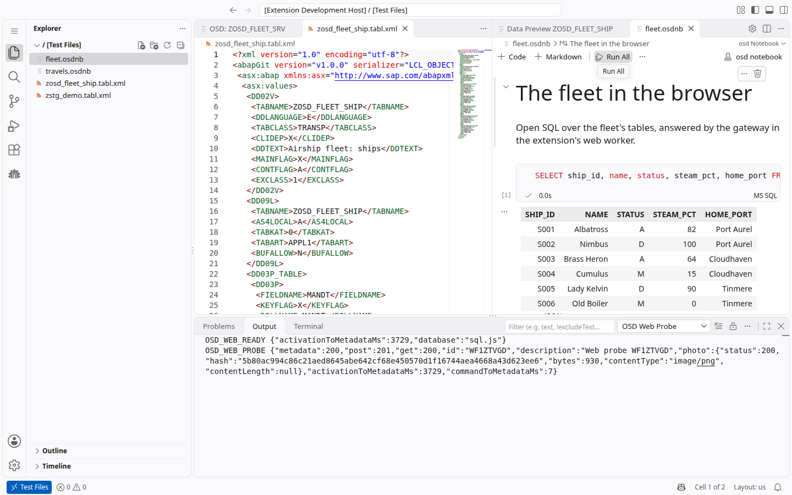
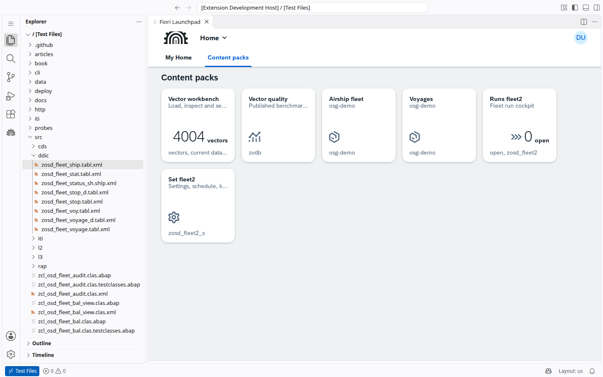
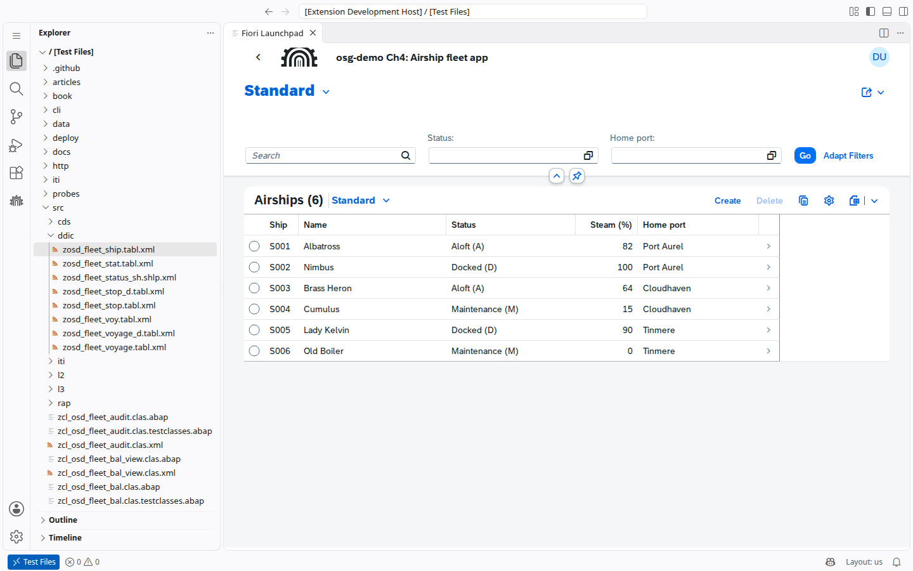
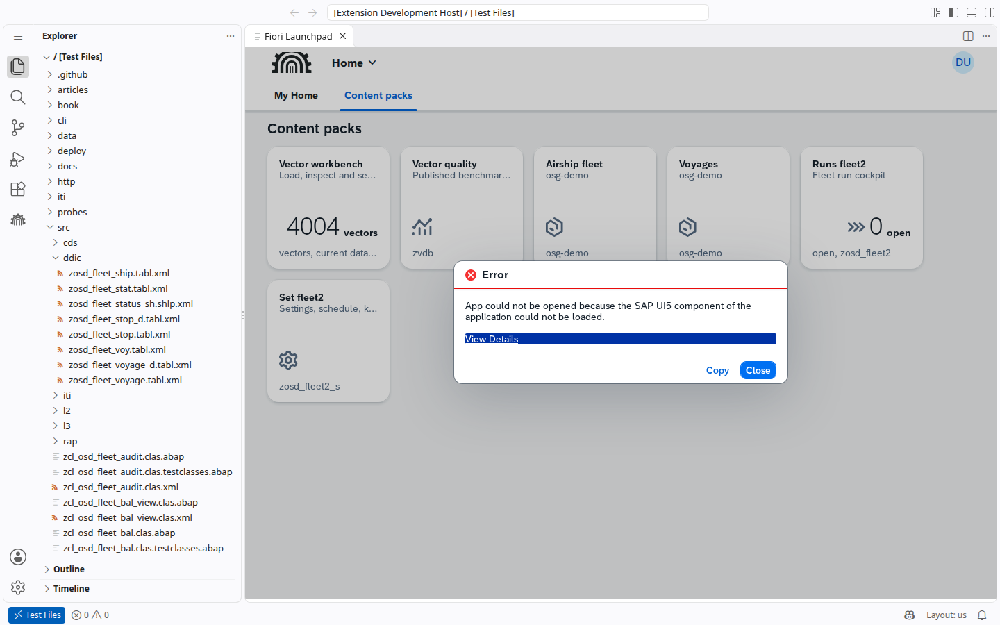
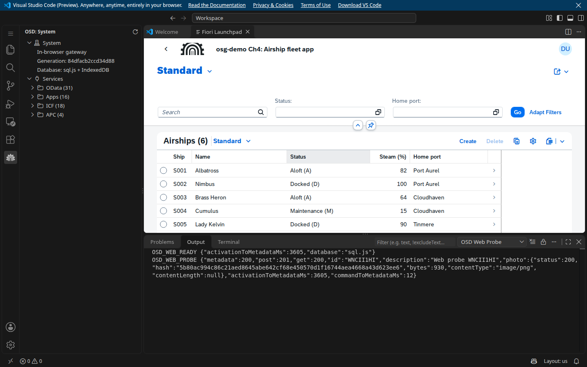

# 23. Флот во вкладке браузера: vscode.dev

До сих пор каждой главе были нужны Node, checkout open-steamgate и порт на
вашей машине. Но VS Code работает и как веб-страница,
[vscode.dev](https://vscode.dev), а расширение может принести с собой часть,
которая работает там. У open-steamgate такая часть есть: его браузерная точка
входа несёт шлюз, уже переведённый в JavaScript, и запускает его в web worker
расширения; база данных — sql.js, а между визитами её хранит IndexedDB
браузера. Сервер не запускается, порт не открывается: запрос приложения Fiori
сообщением уходит в worker и возвращается как ответ HTTP
([docs/vscode-web.md](https://github.com/oisee/open-steamgate/blob/vscode-stable-v0.7.3140/docs/vscode-web.md)).

Одно во вкладку браузера не помещается: транспайлер. В браузере ничто не
превращает ABAP в JavaScript, поэтому там работает только система, собранная
заранее. В этой главе сначала откроем в vscode.dev собственную систему
open-steamgate, потом соберём систему с флотом и принесём её туда, а
закончим там, где браузер останавливается.

## Попробуйте, ничего не устанавливая

Нужен браузер на основе Chromium; глава пройдена в Chromium.

1. Откройте [vscode.dev](https://vscode.dev), панель Extensions, и найдите
   `open-steamgate`. Нажмите **Install**. Ожидается: два вопроса. Первый —
   доверяете ли вы издателю: **Trust Publisher & Install**. Второй
   сообщает, что в VS Code for the Web расширение работает не полностью:
   **Install Anyway**. Через несколько секунд на панели действий появится
   значок OSD. Учётная запись не нужна. (Страница приветствия может
   предложить *Start with the defaults*; эта команда для десктопа, закройте
   страницу.)

2. Откройте представление OSD. Ожидается: в **System** — *In-browser
   gateway*, поколение и *Database: sql.js + IndexedDB*; в **Services** —
   OData (21), Apps (13), ICF (16) и APC (2). Это собственная
   демонстрационная система open-steamgate, та, с которой собран его пакет
   в Marketplace.

3. Нажмите F1 и выполните **osd: Open Fiori Launchpad**. Ожидается: панель
   запуска во вкладке редактора с плитками демо open-steamgate: Travels,
   Bookings, Flight analytics, SEGW, System status и другие. **Workbench**
   серая (*needs the ADT facade*), и **AMDP sandbox** тоже (*no SQLScript
   engine here*). Откройте **Travels**: отчёт-список со строками.

   

4. F1, **osd: Web probe**. Ожидается, в выводе *OSD Web Probe*: строка
   `OSD_WEB_PROBE {"metadata":200,"post":201,"get":200,…}`: worker прочитал
   метаданные службы, создал поездку и прочитал её обратно. Перезагрузите
   страницу (F1, **Developer: Reload Window**), затем F1, **osd: Web verify
   last Travel**. Ожидается: поездка, созданная пробой, прочитанная после
   перезагрузки. Worker выгрузил базу в IndexedDB раньше, чем ответил на
   POST.

Это работающий шлюз во вкладке браузера, но система — open-steamgate, а не
флот. Флоту нужен свой бандл.

## Соберите флот в бандл

Дальше всё происходит в checkout open-steamgate на теге книги, где один раз
сделано `npm ci && npm run bootstrap`, а этот репозиторий лежит рядом.

5. Соберите веб-расширение с этим репозиторием в роли пака:

   ```sh
   OSD_PACKS=$PWD/../osg-demo OSD_WEB_PACKS=all npm run web:vscode
   ```

   Команда транспилирует систему со всеми паками, которые видит, пишет
   начальные данные и таблицы служб и собирает worker. Ожидается, через
   четыре-пять минут: `Packs: o4d, zork, gui-examples, rap-flight, lsd,
   zvdb, travels-a4h, osg-demo`, `Status: 31 OData services, 16 apps, 8
   packs` и `VS Code web bundle (all): raw 66925737 bytes (63.83 MiB), gzip
   7935668 bytes (7.57 MiB)`. Просто `OSD_WEB_PACKS=osg-demo` отклоняется с
   `unknown pack: osg-demo`: на этом теге веб-сборка ищет пак по имени
   только в `packs/` checkout'а, а `all` берёт и паки, которые добавляет
   `OSD_PACKS`.

6. Сначала откройте его в локальном VS Code for the Web, с этим
   репозиторием в роли папки. `@vscode/test-web` управляет своим Chromium,
   который его Playwright один раз скачивает:

   ```sh
   npx -y playwright@1.65.1 install chromium
   npx -y @vscode/test-web --quality stable --browser chromium --extensionDevelopmentPath ./editors/vscode ../osg-demo
   ```

   Ожидается: VS Code for the Web скачивается в `.vscode-test-web/` в
   checkout (потом удалите эту папку), затем открывается окно Chromium с VS
   Code, файлы репозитория в Explorer под меткой `[Test Files]` (так
   test-web называет любую папку) и значок OSD. Откройте представление OSD:
   теперь OData (31) и Apps (16), среди служб OData — `ZOSD_FLEET_SRV` и
   `ZUI_OSD_FLEET_VOY`. Щелчок по `ZOSD_FLEET_SRV` показывает её вид и URL.

   

7. Откройте `src/ddic/zosd_fleet_ship.tabl.xml` и нажмите F8. Ожидается:
   *Data Preview ZOSD_FLEET_SHIP*, шесть строк, от Albatross до Old Boiler,
   как в главе 1. Нажмите **Open in SQL notebook** и на вопрос, доверяете
   ли вы авторам блокнота, ответьте **Open Notebook**: новый блокнот, в
   ячейке `SELECT * FROM ZOSD_FLEET_SHIP WHERE MANDT = '123'`. Запустите её
   кнопкой Run ячейки или Shift+Enter, и под ячейкой появится таблица, со
   столбцом манданта `MANDT`, которого нет в предпросмотре. Ячейка ABAP
   ответила бы, что в браузере она недоступна.

   

   

8. F1, **osd: Open Fiori Launchpad**, вкладка **Content packs**. Ожидается:
   **Airship fleet** и **Voyages**, обе с подзаголовком `osg-demo`.
   Откройте **Airship fleet**: отчёт-список главы 4, *Airships (6)*, со
   статусом и паром, как в начальных данных.

   

   

9. Вернитесь и откройте **Voyages**. Ожидается: ошибка *App could not be
   opened because the SAP UI5 component of the application could not be
   loaded*. Почему — в последнем разделе.

   

## Принесите его в vscode.dev

vscode.dev ставит расширения из Marketplace, а через **Developer: Install
Extension From Location...** — с адреса, который разрешает его политика
безопасности содержимого. Она разрешает `https://localhost`, а не любой
веб-сервер, поэтому open-steamgate отдаёт бандл локально:

10. В checkout open-steamgate:

    ```sh
    npm run web:vscode:stage
    npm run web:vscode:serve
    ```

    Ожидается: подготовленное расширение в `build/preview/vscode-web`,
    затем сервер на `https://localhost:5000` с сертификатом, который он
    сделал сам. Один раз откройте в браузере `https://localhost:5000/` и
    примите сертификат (или сделайте свой через `mkcert localhost` и
    назовите его в `OSD_WEB_CERT` и `OSD_WEB_KEY`).

11. В vscode.dev: F1, **Developer: Install Extension From Location...**,
    `https://localhost:5000`. Браузер спросит, можно ли vscode.dev
    обращаться к локальной сети; вкладке панели запуска, отдельной
    странице, нужно то же самое, так что разрешайте каждый раз, когда
    спрашивает. Ожидается: значок OSD, а в представлении OSD то же
    поколение, что в шаге 6. Панель запуска и приложение Airship fleet
    работают, как там. Папка в vscode.dev сейчас не открыта, так что файла
    таблицы для F8 нет; для этого есть шаг 7. (Если установлено расширение
    из Marketplace из шага 1, сначала удалите его.)

    

В конце остановите сервер через Ctrl+C. Расширение останется в vscode.dev,
но без сервера загрузиться уже не сможет; удалите его на панели Extensions.

## Как запрос туда попадает

Приложение Fiori во вкладке панели запуска — это страница в *webview*
VS Code. SAPUI5 для неё приходит с `ui5.sap.com`, как везде, её собственные
файлы — из расширения. Раньше всего остального расширение вставляет в
страницу скрипт, который заменяет `XMLHttpRequest` и `fetch` версиями,
смотрящими на адрес. Запрос к `…/sap/opu/odata/…` или `…/sap/bc/…` через
`postMessage` уходит в расширение, оно передаёт его шлюзу в worker и
отправляет ответ обратно: статус, заголовки и тело, как их ждёт HTTP-клиент.
Любой другой адрес браузер запрашивает сам, кроме двух мелких, на которые
отвечает сама страница: конфигурация песочницы и вопрос панели запуска, есть
ли ADT (нет, см. ниже).

Шлюз — тот же ABAP, что на десктопе, транспилированный при сборке бандла:
`ZCL_ZOSD_FLEET_DPC_EXT` флота отвечает на список главы 4 в браузере так же,
как на порту 8099. Каждый изменяющий запрос записывает базу sql.js в
IndexedDB, прежде чем ответ уйдёт обратно, поэтому после перезагрузки на
месте то, что записал шаг 4. Сохранённая база принадлежит одной сборке:
новый бандл начинает со своих начальных данных.

## Что остаётся на десктопе

Браузерная точка входа выставляет ключ контекста, и он скрывает меню и
команды расширения, которым нужен Node: **Start**, ABAP Unit и
представление Testing, отладчик, F9, Check и Activate, CodeLens для `.http`,
задания и выгрузку из HANA. Ячейки блокнота на ABAP и SQLScript отвечают,
что в браузере недоступны. Плитка Workbench серая, потому что Workbench
нужен ADT-фасад узла Node. AMDP sandbox серая, потому что выполняет тела
только на HANA; в браузере она серая при любой базе. Если в настройке
`osd.web.database` выбрать `duckdb`, ячейка SQLScript в блокноте работает
через Portable AMDP на DuckDB-Wasm, но база тогда живёт в памяти и при
каждой перезагрузке заполняется заново.

## Где браузер останавливается

Рейсы главы 21 не открываются, по двум причинам, обе — в браузерной точке
входа open-steamgate на этом теге:

- **OData V4 не проходит через мост.** Среда страницы отправляет шлюзу
  только `/sap/opu/odata/` и `/sap/bc/`; приложение Fiori Elements V4
  обращается к `/sap/opu/odata4/`, и этот запрос уходит к файловому серверу
  webview и получает `404`. Собственные плитки V4 open-steamgate, **OData V4
  Travels** и **Draft Trips**, так же не работают и в пакете из Marketplace.
- **Папки BSP пака не попадают в бандл.** Веб-сборка копирует `webapp/`
  каждого пака, но не папки, которые называет его `bsp`, поэтому компонента
  Voyages (`voyage/`, глава 21) в бандле нет вовсе. Это и есть ошибка
  шага 9.

Сами рейсы на месте: `ZUI_OSD_FLEET_VOY` есть в представлении OSD, и её
привязка V2 отвечает тремя рейсами из начальных данных. Но черновикам главы
21 нужно приложение V4, а значит, десктоп.

И ещё две вещи на этом теге:

- **Ставьте из Marketplace или из своей сборки, а не со страницы релиза.**
  Универсальный `open-steamgate-0.7.3140.vsix` в релизе на GitHub объявляет
  браузерную точку входа, но не содержит её; пакет той же версии в
  Marketplace содержит.
- **Сборка ABAP остаётся на десктопе.** Измените класс, и браузер не покажет
  изменения, пока шаг 5 не выполнят снова на машине с Node.

## Проверки

`test/web-shots.mjs` повторяет шаги 6–9 в `@vscode/test-web` с Playwright и
снимает картинки этой главы: активация и первый `$metadata` от worker,
представление OSD, F8, ячейка блокнота, плитки панели запуска, список Airship
fleet, запись через `ZOSD_FLEET_SRV`, которая переживает перезагрузку,
серые плитки, Zork и WEBGUI. Шаги V4 он записывает как известные отказы
этого тега. `test/web-vscodedev.mjs` ставит расширение в настоящий
vscode.dev, из Marketplace или с адреса `https://localhost`, без учётной
записи, и проверяет представление OSD, пробу и панель запуска.
Скрипту `test/web-shots.mjs` и пути `location` нужен веб-бандл, собранный как в
шаге 5; пути `marketplace` нужен только checkout open-steamgate ради его
Playwright. Всем нужна сеть; в CI ни одна не входит.
